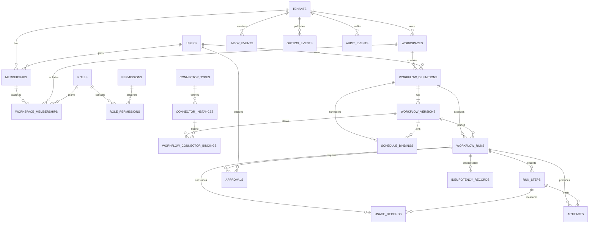

# Database Design

## AI Agency Platform — PostgreSQL

| Atribut | Nilai |
|---|---|
| Versi | 1.1 |
| Status | Draft baseline, diselaraskan dengan n8n Sprint 2 |
| Tanggal | 31 Oktober 2026 |
| Referensi | [SRS.md](./SRS.md), [SDD.md](./SDD.md) |
| Database | PostgreSQL |

## 1. Tujuan dan Batas Desain

Dokumen ini menetapkan rancangan logis database aplikasi: tabel, kolom penting, relasi, indeks, constraint, strategi isolasi tenant, dan ERD.

Database aplikasi menyimpan konfigurasi produk, identitas aplikasi, workflow dan versinya, proyeksi run, approval, jadwal, audit, serta usage. Persistence internal n8n **bukan** bagian dari skema aplikasi; gunakan database n8n terpisah. Sprint 1/2 belum menerapkan tabel domain dalam dokumen ini.

Dokumen ini bukan migration atau kode backend. Tipe dan constraint menjelaskan rancangan yang harus diterjemahkan menjadi migrasi SQL ketika implementasi dimulai.

### 1.1 Asumsi rancangan

- Tipe identifier utama: UUID; waktu disimpan sebagai `timestamptz` dalam UTC.
- Data tenant menggunakan shared PostgreSQL dengan `tenant_id` wajib dan Row-Level Security (RLS) sebagai pertahanan tambahan.
- Tabel katalog global seperti permission dan connector type tidak membawa `tenant_id`; tabel tenant-scoped selalu memilikinya.
- Semua FK antar data tenant harus mempertahankan pasangan `tenant_id` dan identifier untuk mencegah relasi lintas tenant.
- Payload workflow disimpan sebagai JSONB yang tervalidasi. Payload run besar, dokumen, atau artefak disimpan di object storage, bukan di tabel transaksi.
- Published workflow version immutable. `workflow_runs` menunjuk versi yang digunakan agar hasil historis dapat direproduksi.
- Secret tidak pernah disimpan langsung di database; database hanya menyimpan reference ke Secret Manager/KMS.
- n8n menyimpan execution history; tabel run dan step aplikasi adalah proyeksi query produk yang harus diperbarui secara idempoten melalui webhook/callback. Tabel proyeksi belum diimplementasikan pada Sprint 2.

## 2. Konvensi Data

### 2.1 Konvensi kolom umum

| Konvensi | Rancangan |
|---|---|
| Primary key | `id UUID PRIMARY KEY`, dibuat aplikasi atau oleh generator UUID database. |
| Tenant scope | `tenant_id UUID NOT NULL` pada seluruh tabel tenant-scoped. |
| Waktu | `created_at`, `updated_at`, `occurred_at`, dan waktu status menggunakan `timestamptz`. |
| JSONB | Untuk definisi graf, schema, policy snapshot, metadata tersanitasi, dan konfigurasi non-secret yang strukturnya bervariasi. |
| Soft delete | Digunakan terbatas untuk entitas konfigurasi yang perlu dipulihkan/audit; gunakan `deleted_at` atau status `revoked/disabled`. Jangan soft-delete log yang wajib dipertahankan. |
| Status | Disimpan sebagai `text` dengan `CHECK` constraint atau tabel referensi bila lifecycle perlu diubah tanpa migrasi enum. |
| Secret | Hanya simpan `secret_ref`, versi, status, dan metadata non-rahasia; tidak menyimpan token/password/API key plaintext atau ciphertext buatan aplikasi. |

### 2.2 Prinsip multi-tenant

1. Tenant diperoleh dari identity dan membership yang telah diverifikasi, bukan dipercaya dari body request.
2. Semua query tenant-scoped memfilter `tenant_id`, walaupun RLS aktif.
3. RLS diaktifkan dan dipaksa untuk tabel tenant-scoped pada production; role aplikasi tidak memiliki hak bypass RLS.
4. Tenant context di-set per transaksi dan dibersihkan/dibatasi pada akhir transaksi agar koneksi pool tidak membawa konteks request sebelumnya.
5. Composite foreign key berbentuk `(tenant_id, referenced_id)` digunakan untuk relasi dalam tenant. Tabel referensi harus menyediakan unique key yang cocok.
6. Operasi admin lintas tenant memakai jalur identitas dan audit yang terpisah.
7. Test integrasi harus mencoba akses lintas tenant langsung melalui API dan query.

### 2.3 Rekomendasi tipe PostgreSQL

| Jenis data | Tipe yang disarankan | Catatan |
|---|---|---|
| Identifier | `uuid` | PK dan FK; jangan memakai email atau slug sebagai FK. |
| Teks singkat | `text` atau `varchar(n)` | Gunakan batas panjang pada input/domain bila bermakna; `text` menghindari batas arbitrer. |
| JSON terstruktur | `jsonb` | Untuk workflow, schema, policy snapshot, metadata non-secret. Validasi schema dilakukan aplikasi. |
| Status/kode | `text` + `CHECK` | Memudahkan evolusi status; gunakan PostgreSQL enum hanya jika perubahan nilai jarang dan migrasinya terkelola. |
| Waktu | `timestamptz` | Simpan UTC; konversi timezone hanya pada tampilan/jadwal. |
| Nilai uang | `numeric(p,s)` | Jangan gunakan floating point; simpan currency ISO 4217 terpisah. |
| Counter/ukuran | `integer` atau `bigint` | Pilih `bigint` untuk counter kumulatif/volume yang dapat tumbuh besar. |
| Hash | `bytea` atau encoding teks terstandar | Untuk hash idempotency/API key; algoritme dan panjang harus konsisten. |
| Durasi | `bigint` dalam milidetik atau `interval` | Pilih satu representasi yang konsisten; metrik agregat biasanya lebih mudah dengan unit integer. |

Timestamp yang merepresentasikan waktu event wajib berisi nilai eksplisit; jangan memakai waktu lokal tanpa timezone.

## 3. Daftar Tabel

Tabel bertanda **MVP** termasuk rancangan inti. **Lanjutan** disediakan untuk kebutuhan fase berikutnya dari SRS dan tidak harus dibuat pada migrasi awal.

### 3.1 Tenant, pengguna, dan otorisasi

| Tabel | Kolom penting | Kunci dan constraint utama | Fungsi |
|---|---|---|---|
| `tenants` (MVP) | `id`, `name`, `slug`, `status`, `region`, `created_at`, `updated_at` | PK `id`; unique `slug`; `status` salah satu `active`, `suspended`, `closed` | Organisasi dan batas tenant. |
| `users` (MVP) | `id`, `identity_issuer`, `identity_subject`, `email`, `display_name`, `status`, timestamps | PK `id`; unique `(identity_issuer, identity_subject)`; status `active`, `disabled`, `pending` | Profil aplikasi yang terhubung ke OIDC subject. Password tidak disimpan bila identitas dikelola IdP. |
| `memberships` (MVP) | `tenant_id`, `user_id`, `status`, `joined_at`, `created_at` | PK `(tenant_id, user_id)`; FK `tenant_id` → `tenants`; FK `user_id` → `users`; status `invited`, `active`, `suspended`, `revoked` | Keanggotaan user di organisasi. |
| `workspaces` (MVP) | `id`, `tenant_id`, `name`, `slug`, `status`, `created_by`, timestamps | PK `id`; unique `(tenant_id, id)` dan `(tenant_id, slug)`; FK tenant; status `active`, `archived` | Ruang kerja dalam tenant. |
| `workspace_memberships` (MVP) | `tenant_id`, `workspace_id`, `user_id`, `role_id`, `status`, `created_at` | PK `(tenant_id, workspace_id, user_id)`; FK workspace, membership, role dalam tenant; status `active`, `revoked` | Hak pengguna pada workspace. |
| `roles` (MVP) | `id`, `tenant_id` nullable, `code`, `name`, `is_system`, `created_at` | PK `id`; global role memiliki `tenant_id IS NULL`; unique global `(code)` dan unique tenant `(tenant_id, code)` | Role bawaan dan role khusus organisasi. Gunakan unique index parsial untuk memisahkan role global dan tenant. Global role tidak boleh langsung diperlakukan sebagai role tenant tanpa validasi scope. |
| `permissions` (MVP) | `id`, `code`, `description` | PK `id`; unique `code` | Katalog permission yang dikelola platform. |
| `role_permissions` (MVP) | `role_id`, `permission_id` | PK `(role_id, permission_id)`; FK role dan permission | Relasi many-to-many role ke permission. |
| `workflow_access_grants` (MVP) | `tenant_id`, `workflow_id`, `user_id`, `permission_level`, `granted_by`, `created_at` | PK `(tenant_id, workflow_id, user_id)`; FK workflow dan membership; level `view`, `edit`, `publish`, `admin` | Akses workflow spesifik bila RBAC workspace tidak cukup. |
| `api_clients` (MVP) | `id`, `tenant_id`, `name`, `status`, `created_by`, `last_used_at`, timestamps | PK `id`; unique `(tenant_id, id)`; FK tenant; status `active`, `disabled`, `revoked` | Identitas client untuk integrasi machine-to-machine. |
| `api_client_keys` (MVP) | `id`, `tenant_id`, `api_client_id`, `key_prefix`, `key_hash`, `scopes`, `expires_at`, `revoked_at`, `created_at` | PK `id`; unique `key_hash`; FK client; `key_hash` wajib; `expires_at > created_at` bila ada | Simpan hash key, tidak pernah nilai key mentah; key mentah hanya ditampilkan sekali saat penerbitan. |

### 3.2 Workflow dan konektor

| Tabel | Kolom penting | Kunci dan constraint utama | Fungsi |
|---|---|---|---|
| `workflow_definitions` (MVP) | `id`, `tenant_id`, `workspace_id`, `name`, `slug`, `description`, `owner_user_id`, `status`, `active_version_id`, timestamps, `deleted_at` | PK `id`; unique `(tenant_id, id)` dan `(tenant_id, workspace_id, slug)`; FK workspace dan membership pemilik; status `draft`, `published`, `disabled`, `archived` | Identitas workflow yang stabil dan pointer ke versi aktif. |
| `workflow_versions` (MVP) | `id`, `tenant_id`, `workflow_id`, `version_number`, `lifecycle_status`, `definition_json`, `input_schema`, `output_schema`, `change_summary`, `created_by`, `created_at`, `published_at` | PK `id`; unique `(tenant_id, id)`, `(tenant_id, workflow_id, id)`, `(tenant_id, workflow_id, version_number)`; FK workflow; `version_number > 0`; status `draft`, `published`, `retired` | Graph dan kontrak workflow per versi. Isi published tidak boleh diubah. |
| `workflow_templates` (MVP/S) | `id`, `tenant_id` nullable, `name`, `description`, `definition_json`, `input_schema`, `output_schema`, `visibility`, `created_by`, timestamps | PK `id`; global atau tenant-scoped; visibility `private`, `tenant`, `platform`; constraint bahwa template tenant-scoped harus menunjuk tenant valid | Template platform dan template organisasi. |
| `connector_types` (MVP) | `id`, `code`, `name`, `version`, `config_schema`, `capabilities`, `status` | PK `id`; unique `(code, version)`; status `active`, `deprecated` | Katalog connector global dan schema konfigurasi non-secret. |
| `connector_instances` (MVP) | `id`, `tenant_id`, `workspace_id`, `connector_type_id`, `name`, `config_json`, `credential_ref`, `credential_version`, `status`, `last_health_check_at`, timestamps | PK `id`; unique `(tenant_id, id)`; FK workspace dan connector type; status `active`, `disabled`, `needs_attention`, `revoked`; secret hanya berupa reference | Konfigurasi konektor yang diotorisasi. |
| `workflow_connector_bindings` (MVP) | `tenant_id`, `workflow_version_id`, `connector_instance_id`, `allowed_operations`, `created_at` | PK `(tenant_id, workflow_version_id, connector_instance_id)`; FK ke workflow version dan connector instance dalam tenant; operasi tidak boleh kosong | Membatasi connector serta operasi yang boleh digunakan oleh versi workflow tertentu. |
| `tenant_ai_policies` (MVP) | `id`, `tenant_id`, `policy_name`, `allowed_provider_codes`, `allowed_model_codes`, `max_tokens_per_run`, `max_cost_per_run`, `max_cost_period`, `redaction_mode`, `require_approval_risk_level`, `status`, timestamps | PK `id`; unique `(tenant_id, policy_name)`; FK tenant; batas token/biaya non-negatif; status `active`, `disabled` | Batas provider/model, usage, redaction, dan approval di tingkat tenant. |

`allowed_provider_codes` dan `allowed_model_codes` berupa JSONB hanya untuk policy allowlist yang perlu berubah tanpa migrasi. Nilai harus divalidasi terhadap katalog server-side; jangan menerima endpoint provider bebas dari pengguna.

### 3.3 Eksekusi, approval, dan jadwal

| Tabel | Kolom penting | Kunci dan constraint utama | Fungsi |
|---|---|---|---|
| `workflow_runs` (MVP) | `id`, `tenant_id`, `workflow_id`, `workflow_version_id`, `n8n_workflow_id`, `n8n_execution_id`, `trigger_type`, `trigger_actor_id`, `status`, `idempotency_record_id`, `input_ref`, `result_ref`, `error_code`, `started_at`, `completed_at`, `created_at`, `correlation_id` | PK `id`; unique `(tenant_id, id)`; unique `(n8n_execution_id)` bila tersedia; composite FK `(tenant_id, workflow_id, workflow_version_id)` ke workflow version; status `queued`, `running`, `waiting_approval`, `succeeded`, `failed`, `cancelled`, `timed_out`; `completed_at >= started_at` bila keduanya ada | Proyeksi produk satu execution n8n, pinned ke versi aplikasi workflow yang sama. |
| `run_steps` (MVP) | `id`, `tenant_id`, `run_id`, `step_key`, `attempt_number`, `status`, `started_at`, `completed_at`, `duration_ms`, `error_code`, `error_summary`, `result_ref`, `created_at` | PK `id`; unique `(tenant_id, run_id, step_key, attempt_number)`; FK run dalam tenant; `attempt_number > 0`; status `pending`, `running`, `succeeded`, `failed`, `skipped`, `waiting_approval`, `cancelled` | Ringkasan status tiap langkah dari callback/projection; bukan sumber state internal n8n. |
| `approvals` (MVP) | `id`, `tenant_id`, `run_id`, `step_key`, `status`, `requested_at`, `expires_at`, `decided_by`, `decision_at`, `decision_reason`, `policy_snapshot`, `created_at` | PK `id`; unique `(tenant_id, id)`; FK run dan approver membership; status `pending`, `approved`, `rejected`, `expired`, `cancelled`; constraint keputusan dan `decision_at` konsisten dengan status | Keputusan HITL yang dapat diaudit. |
| `idempotency_records` (MVP) | `id`, `tenant_id`, `scope`, `key_hash`, `request_hash`, `run_id`, `response_code`, `created_at`, `expires_at` | PK `id`; unique `(tenant_id, scope, key_hash)`; FK run opsional dalam tenant; `expires_at > created_at`; hanya hash key yang disimpan | Dedup trigger dan operasi API yang dapat diulang. |
| `schedule_bindings` (MVP) | `id`, `tenant_id`, `workflow_id`, `workflow_version_id`, `n8n_workflow_id`, `cron_spec`, `timezone`, `overlap_policy`, `missed_run_policy`, `enabled`, `created_by`, timestamps | PK `id`; unique `(tenant_id, id)`; unique `(n8n_workflow_id)` bila satu jadwal per workflow; composite FK `(tenant_id, workflow_id, workflow_version_id)` ke workflow version; overlap `skip`, `buffer_one`, `allow`; missed-run policy `skip`, `catch_up_once`, `catch_up_all`; IANA timezone wajib | Proyeksi jadwal produk yang dikelola melalui workflow n8n Schedule Trigger. |
| `inbox_events` (MVP/S) | `id`, `tenant_id`, `source`, `external_event_id`, `event_type`, `received_at`, `status`, `payload_ref`, `signature_verified_at`, `processed_at`, `error_code` | PK `id`; unique `(tenant_id, source, external_event_id)`; status `received`, `validated`, `queued`, `processed`, `rejected`, `failed` | Durable ingress, dedup event, dan replay protection. |
| `outbox_events` (MVP) | `id`, `tenant_id`, `event_type`, `aggregate_type`, `aggregate_id`, `payload_json`, `created_at`, `available_at`, `published_at`, `attempt_count`, `last_error_code`, `lease_until` | PK `id`; tenant FK; attempt non-negatif; payload tidak mengandung secret; event pending saat `published_at IS NULL` | Atomic handoff dari transaksi produk ke trigger n8n/notifikasi. |

### 3.4 Audit, usage, artefak, dan notifikasi

| Tabel | Kolom penting | Kunci dan constraint utama | Fungsi |
|---|---|---|---|
| `audit_events` (MVP) | `id`, `tenant_id` nullable untuk aksi platform, `actor_type`, `actor_id`, `action`, `target_type`, `target_id`, `occurred_at`, `correlation_id`, `metadata_json`, `source_ip_hash` | PK `id`; tenant FK bila tenant-scoped; metadata tersanitasi; tidak ada update/delete oleh role aplikasi | Jejak append-only untuk aksi keamanan dan perubahan konfigurasi. |
| `usage_records` (MVP) | `id`, `tenant_id`, `run_id`, `run_step_id`, `provider_code`, `model_code`, `usage_type`, `input_units`, `output_units`, `estimated_cost`, `currency`, `occurred_at`, `metadata_json` | PK `id`; FK run/step dalam tenant; unit/biaya non-negatif; penggunaan menyimpan snapshot provider/model | Biaya dan konsumsi AI atau connector per tenant/workflow/run. |
| `artifacts` (MVP) | `id`, `tenant_id`, `run_id`, `run_step_id`, `storage_key`, `content_type`, `size_bytes`, `checksum`, `classification`, `expires_at`, `created_at` | PK `id`; unique `(tenant_id, storage_key)`; FK run/step; `size_bytes >= 0`; classification sesuai katalog | Referensi object storage untuk payload atau hasil besar. |
| `notification_preferences` (MVP/S) | `id`, `tenant_id`, `user_id`, `event_type`, `channel`, `enabled`, `created_at`, `updated_at` | PK `id`; unique `(tenant_id, user_id, event_type, channel)`; FK membership; channel `email`, `chat`, `in_app`, `webhook` | Preferensi pemberitahuan per user dan tenant. |
| `notifications` (MVP/S) | `id`, `tenant_id`, `recipient_user_id`, `event_type`, `channel`, `status`, `related_run_id`, `payload_ref`, `attempt_count`, `created_at`, `sent_at`, `last_error_code` | PK `id`; FK membership/run; status `queued`, `sent`, `failed`, `cancelled`; retry count non-negatif | Status delivery notifikasi. |

### 3.5 Tabel fase lanjutan

Tabel ini belum wajib untuk MVP. Buat setelah kebutuhan dan lifecycle data RAG/evaluasi disetujui.

| Tabel | Kolom penting | Constraint utama | Fungsi |
|---|---|---|---|
| `evaluation_suites` | `id`, `tenant_id`, `workflow_id`, `name`, `created_by`, timestamps | Unique `(tenant_id, workflow_id, name)`; FK workflow | Kumpulan evaluasi workflow AI. |
| `evaluation_cases` | `id`, `tenant_id`, `suite_id`, `case_key`, `input_json`, `expected_json`, `created_at` | Unique `(tenant_id, suite_id, case_key)`; FK suite | Kasus uji dan hasil yang diharapkan; akses dan retensi mengikuti klasifikasi data. |
| `evaluation_runs` | `id`, `tenant_id`, `suite_id`, `workflow_version_id`, `status`, `started_at`, `completed_at`, `summary_json` | FK suite dan versi tenant; status tervalidasi | Hasil evaluasi terhadap satu versi workflow. |
| `evaluation_case_results` | `id`, `tenant_id`, `evaluation_run_id`, `case_id`, `status`, `score`, `result_ref`, `error_code` | Unique `(tenant_id, evaluation_run_id, case_id)`; FK run/case | Hasil per kasus uji. |
| `knowledge_sources` | `id`, `tenant_id`, `workspace_id`, `name`, `source_type`, `config_json`, `credential_ref`, `status`, timestamps | FK workspace; credential reference saja; source type allowlisted | Sumber dokumen retrieval dengan ACL dan retensi. |
| `knowledge_documents` | `id`, `tenant_id`, `source_id`, `external_document_id`, `content_hash`, `storage_ref`, `metadata_json`, `indexed_at`, `deleted_at` | Unique `(tenant_id, source_id, external_document_id)`; FK source | Metadata dan referensi dokumen; konten dapat berada di object/vector store. |

Embedding/chunk dapat dikelola pada vector store terpisah. Bila PostgreSQL + pgvector dipilih, rancangan tabel chunk dan indeks vector harus ditetapkan setelah dimensi embedding, kebutuhan ACL, volume, dan lifecycle dokumen diputuskan; jangan menyimpan embedding sebelum keputusan tersebut.

## 4. Relasi Antar Tabel

1. **Tenant ke anggota:** `tenants 1—N memberships`; setiap membership menunjuk satu user global.
2. **User dan role:** role permission bersifat many-to-many melalui `role_permissions`; membership workspace memberi satu role melalui `workspace_memberships`. Hak workflow lebih spesifik dapat ditambah melalui `workflow_access_grants`.
3. **Tenant ke workspace:** satu tenant memiliki banyak workspace. Workspace hanya dapat mereferensikan tenant yang sama.
4. **Workflow:** satu workspace memiliki banyak `workflow_definitions`; satu workflow memiliki banyak `workflow_versions`. Definisi menyimpan `active_version_id`, versi menyimpan isi immutable.
5. **Connector:** tenant memiliki connector instances; setiap instance mengacu pada satu global connector type. Binding menghubungkan workflow version dengan connector instance dan subset operasi yang diizinkan.
6. **Eksekusi:** satu workflow version memiliki banyak `workflow_runs`; satu run memiliki banyak `run_steps`, approvals, usage records, dan artifacts.
7. **Approval:** setiap approval menunjuk run dan step; approver harus terdaftar sebagai membership tenant yang sama.
8. **Jadwal:** schedule binding menunjuk workflow dan versi tertentu; eksekusi jadwal membuat run reguler.
9. **Idempotency:** record dapat menunjuk workflow run yang diterima; kombinasi tenant/scope/hash unik selama record hidup.
10. **Integrasi event:** satu inbox event dapat menghasilkan event outbox/start workflow; outbox bersifat transaksional dan diproses ulang secara aman.
11. **Audit/usage:** audit dapat mencakup aksi platform tanpa tenant atau aksi tenant-scoped; usage selalu terkait tenant dan dapat menunjuk run/step.
12. **Artefak/notifikasi:** artifacts menunjuk run/step; notifikasi dapat menunjuk user dan run, tetapi payload besar/sensitif memakai reference.

## 5. ERD

ERD berikut menampilkan relasi inti. Tabel katalog, API client, template, notifikasi, dan tabel evaluasi lanjutan dijelaskan pada inventaris, tetapi tidak seluruhnya ditampilkan agar diagram tetap terbaca.

### 5.1 Catatan relasi siklik

`workflow_definitions.active_version_id` menunjuk salah satu `workflow_versions` milik workflow yang sama. Karena ada relasi balik dari version ke definition, FK pointer aktif dapat ditambahkan setelah tabel dibuat. FK harus composite `(tenant_id, workflow_id, active_version_id)` menuju versi dengan kunci unik yang sama sehingga pointer tidak dapat menyeberang tenant atau workflow.

## 6. Indeks

Primary key dan unique constraint menghasilkan indeks unik. Indeks berikut merupakan baseline; konfirmasi dengan `EXPLAIN (ANALYZE, BUFFERS)` menggunakan data representatif. Indeks tambahan memperlambat write dan menambah storage, jadi hindari indeks duplikat.

### 6.1 Indeks unik dan constraint-backed

| Tabel | Indeks / unique key | Tujuan |
|---|---|---|
| `tenants` | unique `(slug)` | Lookup tenant dari slug. |
| `users` | unique `(identity_issuer, identity_subject)` | Identitas provider unik. |
| `memberships` | PK `(tenant_id, user_id)` | Satu membership per tenant-user. |
| `workspaces` | unique `(tenant_id, id)`, `(tenant_id, slug)` | FK tenant-safe dan slug unik di tenant. |
| `workspace_memberships` | PK `(tenant_id, workspace_id, user_id)` | Lookup membership workspace. |
| `roles` | unique parsial global `(code)` untuk `tenant_id IS NULL`; unique `(tenant_id, code)` untuk role tenant | Mencegah role duplikat sesuai scope. |
| `permissions` | unique `(code)` | Permission code global unik. |
| `role_permissions` | PK `(role_id, permission_id)` | Satu binding permission per role. |
| `workflow_definitions` | unique `(tenant_id, id)`, `(tenant_id, workspace_id, slug)` | FK tenant-safe dan nama pendek stabil. |
| `workflow_versions` | unique `(tenant_id, id)`, `(tenant_id, workflow_id, id)`, `(tenant_id, workflow_id, version_number)` | FK tenant-safe dan nomor versi unik. |
| `connector_instances` | unique `(tenant_id, id)` | Referensi tenant-safe. |
| `workflow_runs` | unique `(tenant_id, id)`, `(n8n_execution_id)` | Lookup run tenant-safe dan dedup execution n8n. |
| `idempotency_records` | unique `(tenant_id, scope, key_hash)` | Mencegah trigger duplikat. |
| `inbox_events` | unique `(tenant_id, source, external_event_id)` | Dedup webhook/event eksternal. |
| `outbox_events` | PK `id` | Identitas event durable. |
| `api_client_keys` | unique `(key_hash)` | Lookup key hash unik. |
| `schedule_bindings` | unique `(n8n_workflow_id)` bila satu jadwal per workflow | Hindari binding jadwal produk ganda ke workflow n8n yang sama. |

Untuk `roles`, PostgreSQL memerlukan dua unique index parsial terpisah atau rancangan normalisasi ekuivalen agar nilai `NULL` global tidak mengizinkan duplikat yang tidak diinginkan.

### 6.2 Indeks pencarian operasional

| Tabel | Indeks yang disarankan | Query yang didukung |
|---|---|---|
| `memberships` | `(user_id, status)` | Menampilkan tenant aktif milik user. |
| `workspaces` | `(tenant_id, status, name)` | Daftar workspace aktif. |
| `workspace_memberships` | `(tenant_id, user_id, status)` | Daftar workspace/role user di tenant. |
| `workflow_definitions` | `(tenant_id, workspace_id, status, updated_at DESC)` | Daftar workflow pada workspace. |
| `workflow_versions` | `(tenant_id, workflow_id, created_at DESC)` | Riwayat versi. |
| `connector_instances` | `(tenant_id, workspace_id, status)` | Connector aktif per workspace. |
| `workflow_runs` | `(tenant_id, status, created_at DESC)` | Dashboard run per status/waktu. |
| `workflow_runs` | `(tenant_id, workflow_id, created_at DESC)` | Riwayat workflow. |
| `workflow_runs` | `(tenant_id, correlation_id)` | Investigasi request dan trace. |
| `run_steps` | `(tenant_id, run_id, created_at)` | Timeline run. |
| `approvals` | `(tenant_id, status, requested_at)` | Inbox approval yang menunggu. |
| `approvals` | partial `(tenant_id, decided_by, decision_at DESC)` where `decided_by IS NOT NULL` | Riwayat keputusan approver. |
| `idempotency_records` | `(expires_at)` | Pembersihan record kadaluarsa. |
| `inbox_events` | `(status, received_at)` | Reconciliation event yang belum diproses; index parsial untuk status non-terminal. |
| `outbox_events` | partial `(available_at, created_at)` where `published_at IS NULL` | Claim event siap dikirim. |
| `audit_events` | `(tenant_id, occurred_at DESC)` dan `(tenant_id, target_type, target_id, occurred_at DESC)` | Audit tenant dan target tertentu. Untuk event platform, indeks terpisah pada `occurred_at`. |
| `usage_records` | `(tenant_id, occurred_at DESC)` dan `(tenant_id, run_id)` | Dashboard pemakaian dan rincian run. |
| `artifacts` | `(tenant_id, run_id, created_at)` serta unique `(tenant_id, storage_key)` | Lookup artefak terkait run. |
| `schedule_bindings` | partial `(tenant_id, enabled)` where `enabled = true` | Rekonsiliasi jadwal aktif. |
| `notifications` | `(tenant_id, recipient_user_id, status, created_at DESC)` | Inbox notifikasi user. |
| `api_client_keys` | `(tenant_id, api_client_id, revoked_at)` | Pengelolaan key aktif/revoked. |

### 6.3 JSONB dan pencarian teks

- Jangan membuat GIN index atas semua kolom JSONB secara default. Tambahkan hanya untuk query yang terukur dan gunakan expression/path index bila query memiliki path stabil.
- `definition_json` berukuran besar dan immutable setelah publish; jangan mengindeks seluruh graph. Indeks workflow/version metadata cukup untuk query operasional.
- Pencarian nama/slug gunakan B-tree atau trigram setelah kebutuhan pencarian parsial terukur.
- Pencarian audit/run yang besar dapat dipindah ke read replica atau log analytics setelah volume mengharuskan; PostgreSQL tetap menjadi sumber data transaksional.

### 6.4 Partisi

Awal MVP tidak memerlukan partisi. Pertimbangkan range partition berdasarkan waktu pada `audit_events`, `usage_records`, dan `workflow_runs` bila volume/retensi memerlukannya. Karena PostgreSQL membatasi unique constraint pada tabel partisi, desain partition key harus kompatibel dengan keunikan tenant/ID dan foreign key sebelum diterapkan. Partisi bukan mekanisme isolasi tenant.

## 7. Constraint dan Integritas Data

### 7.1 Primary key dan foreign key

- Semua entitas memiliki PK UUID; tabel relasi murni dapat memakai composite PK.
- FK tenant-scoped harus memuat `tenant_id`, misalnya `(tenant_id, workflow_id)` menuju unique `(tenant_id, id)`.
- Hapus tenant/workspace/user tidak boleh melakukan cascade terhadap audit, run, atau usage yang wajib dipertahankan.
- Gunakan `ON DELETE RESTRICT` untuk data historis penting dan gunakan status `archived`, `revoked`, atau `disabled` untuk lifecycle normal.
- Cascade dapat dipakai hanya untuk data turunan yang aman dihapus, seperti relasi `role_permissions` saat role tenant dihapus sesuai policy.
- FK `created_by`, `owner_user_id`, `decided_by`, dan actor yang mewakili user harus disertai validasi membership tenant; FK global ke `users` saja tidak membuktikan membership aktif.

### 7.2 Check constraint dan domain

Terapkan `CHECK` constraint untuk:

- Status hanya anggota daftar status yang ditentukan.
- `version_number > 0`; `attempt_number > 0`; `attempt_count >= 0`.
- Durasi, ukuran byte, token/unit, dan biaya bernilai non-negatif.
- `completed_at >= started_at` jika kedua nilai tersedia.
- `expires_at > created_at` untuk idempotency key dan key API.
- Approval `approved/rejected` mensyaratkan `decided_by` dan `decision_at`; status `pending` tidak memiliki keputusan final.
- Payload schema dan graph bukan JSON `null`; validasi struktur lengkap dilakukan di aplikasi sebelum persist.
- `workflow_connector_bindings.allowed_operations` tidak kosong dan subset operasi connector yang terdaftar.
- Jadwal memakai timezone valid dan overlap/missed-run policy salah satu nilai yang didukung.

Constraint yang memeriksa format atau validitas eksternal seperti IANA timezone, provider allowlist, graph workflow, atau credential reference harus divalidasi aplikasi; `CHECK` SQL tidak menggantikan policy service.

### 7.3 Immutability dan lifecycle

- Setelah `workflow_versions.lifecycle_status = 'published'`, kolom definisi/schema/nomor versi tidak dapat diubah. Perubahan policy yang merupakan bagian dari workflow harus menghasilkan versi baru atau policy snapshot yang eksplisit.
- Pointer `active_version_id` harus menunjuk versi milik definition yang sama dan berstatus published.
- `audit_events` bersifat append-only: role aplikasi tidak diberi `UPDATE`/`DELETE`; koreksi dilakukan melalui event kompensasi.
- `usage_records` historis tidak ditimpa untuk mengubah biaya; koreksi dibuat sebagai record adjustment yang dapat ditelusuri jika diperlukan.
- Credential rotation memperbarui reference/version metadata, tidak mengubah workflow version atau mengekspos secret.
- Idempotency record hanya dapat dibersihkan setelah expiration policy; dedup inbox event dipertahankan setidaknya selama jendela replay provider.

### 7.4 Constraint lintas baris/tabel

Constraint berikut tidak dapat dijamin dengan `CHECK` biasa dan memerlukan transaksi aplikasi, trigger terbatas, atau validasi sebelum commit:

- `active_version_id` merupakan versi published dari workflow yang sama.
- `workflow_runs.workflow_version_id` dan `schedule_bindings.workflow_version_id` termasuk workflow yang ditunjuk; gunakan composite FK `(tenant_id, workflow_id, workflow_version_id)` agar hubungan ini ditegakkan database.
- Approver aktif dalam tenant yang sama dan punya permission pada scope yang disetujui.
- Workflow connector binding hanya merujuk connector aktif dengan operasi yang diizinkan.
- Workflow run hanya dibuat untuk versi published dan tenant/workspace yang aktif.
- Role pada `workspace_memberships` harus merupakan role global yang memang boleh dipakai atau role dengan scope tenant yang sama. Karena `roles.tenant_id` nullable, aturan scope role memerlukan validasi aplikasi/trigger; alternatif yang lebih ketat adalah memisahkan katalog platform role dan role tenant.
- Total penggunaan belum melampaui quota saat menerima run; quota perlu enforcement transaksional/atomik untuk menghindari race.
- Hanya satu approval aktif per run-step-policy, bila aturan bisnis membutuhkan single pending approval.

Gunakan trigger hanya untuk integritas yang memang harus dijaga database; aturan bisnis dan otorisasi tetap dievaluasi pada service.

## 8. Transaksi, Outbox, dan Konsistensi

### 8.1 Menerima trigger

Untuk trigger yang membutuhkan penerimaan durable, dalam satu transaksi aplikasi:

1. Validasi tenant, workflow version, kuota, dan idempotency key.
2. Buat `workflow_runs` berstatus `queued`.
3. Buat `idempotency_records` dan kaitkan ke run.
4. Buat `outbox_events` untuk memulai workflow n8n.
5. Commit sebelum mengembalikan HTTP 202.

Outbox publisher memanggil webhook/API workflow n8n dengan idempotency key stabil yang diturunkan dari tenant dan run. Setelah pemanggilan berhasil, event ditandai published. Karena n8n tidak menyediakan jaminan exactly-once untuk efek eksternal, callback dan node yang berdampak harus memiliki deduplication/reconciliation yang sesuai.

### 8.2 Memproyeksikan status eksekusi

Callback n8n yang terautentikasi atau observer memperbarui `workflow_runs` dan `run_steps` secara idempoten. Database proyeksi bukan pengganti execution history n8n. Bila terjadi ketidaksesuaian, rekonsiliasi membaca status execution dari n8n API yang dibatasi dan memperbaiki proyeksi dengan mencatat telemetry/audit yang sesuai.

### 8.3 Inbox webhook

Simpan event yang telah lolos validasi signature dan replay check ke `inbox_events` sebelum mengakui penerimaan kepada provider. Pemroses event mengubah status secara transaksional dan membuat outbox untuk start workflow. Unique `(tenant_id, source, external_event_id)` mencegah replay menghasilkan run duplikat.

## 9. Retensi, Backup, dan Operasional Database

- Retensi ditetapkan per kategori: audit, run/step metadata, payload/artifact, idempotency key, inbox/outbox, usage, serta notification delivery.
- Penghapusan payload mengikuti kebijakan tenant dan menghapus object storage melalui proses yang idempoten; metadata audit minimal dapat dipertahankan bila diwajibkan.
- Backup PostgreSQL dienkripsi, mendukung point-in-time recovery, memiliki retensi yang disepakati, dan diuji dengan restore drill.
- Perubahan skema menggunakan migrasi berversi expand/contract; migrasi destructive tidak dilakukan saat versi aplikasi lama masih aktif.
- Connection pooling dibatasi dan diuji bersama RLS; tenant context harus transaction-local.
- Metrik database meliputi kapasitas koneksi, latency query, lock wait, deadlock, replication lag, pertumbuhan tabel/index, serta status backup.
- Data volume tinggi (`audit_events`, `usage_records`, `workflow_runs`) dievaluasi untuk partisi/arsip menggunakan statistik nyata.
- Database internal n8n dicadangkan dan dipulihkan terpisah dari database aplikasi. Retensi execution data n8n harus diatur agar sesuai kebijakan privasi dan kapasitas storage.

## 10. Checklist Implementasi Database

Sebelum production:

1. Semua tenant-scoped table telah memiliki RLS policy dan indeks tenant.
2. Role aplikasi tidak dapat bypass RLS atau mengubah audit history.
3. Composite FK telah mencegah relasi lintas tenant untuk seluruh relasi penting.
4. Uji negatif lintas tenant, pengujian connection pool, dan pemeriksaan transaksi telah lulus.
5. Unique idempotency dan inbox constraint telah diuji pada request/event konkuren.
6. Outbox publisher dapat pulih setelah restart dan tidak memulai duplicate run.
7. Published workflow immutability dan pointer versi aktif telah ditegakkan.
8. Indeks utama telah diverifikasi dengan query representatif dan rencana eksekusi.
9. Backup dan pemulihan database aplikasi serta database n8n telah dibuktikan terhadap target RPO/RTO.
10. Retensi, penghapusan, masking, dan akses ekspor disetujui oleh pemilik produk, keamanan, dan legal.

## 11. Keputusan yang Masih Memerlukan Persetujuan

1. Apakah database dedicated diperlukan bagi tier tenant enterprise atau lokasi data tertentu.
2. Retensi final untuk audit, run, prompt/output, artifact, inbox, dan usage.
3. Apakah user global lintas tenant diizinkan atau identitas perlu dipisah per organisasi.
4. Skema key management serta nama dan format credential reference dari secret manager.
5. Model kuota dan mekanisme reservasi biaya yang harus atomik sebelum run dimulai.
6. Apakah evaluasi AI dan retrieval masuk fase awal atau tetap fase lanjutan.
7. Threshold volume untuk partitioning dan penggunaan read replica.

Keputusan ini perlu dicatat sebagai ADR dan kebijakan data sebelum migrasi production dikunci.
