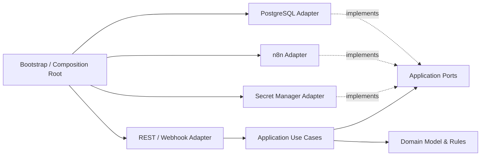

# Folder Structure

## AI Agency Platform — Clean Architecture

| Atribut | Nilai |
|---|---|
| Versi | 1.3 |
| Status | Draft baseline, memetakan konfigurasi production deployment |
| Tanggal | 31 Oktober 2026 |
| Runtime aplikasi | Node.js + TypeScript |
| Workflow engine | n8n |
| Container | Docker / OCI |
| Referensi | [SRS.md](./SRS.md), [SDD.md](./SDD.md), [DATABASE-DESIGN.md](./DATABASE-DESIGN.md), [API-DESIGN.md](./API-DESIGN.md) |

## 1. Keputusan Arsitektur

Atas keputusan produk terbaru, **n8n menggantikan Temporal sebagai workflow execution engine**. n8n dijalankan sebagai runtime/container terpisah; source code n8n tidak dicampur ke domain aplikasi.

Aplikasi platform tetap bertanggung jawab atas tenant, identitas, RBAC, katalog workflow/versi, API publik, kebijakan, approval, audit, usage, dan proyeksi run. n8n menjalankan workflow yang telah diterbitkan dan mengirim status melalui callback/webhook terautentikasi. Adapter aplikasi menerjemahkan definisi workflow yang canonical di platform ke workflow n8n yang diaktifkan.

### 1.1 Batas ownership

| Data/kapabilitas | Pemilik |
|---|---|
| Tenant, workspace, user, role, permission | PostgreSQL aplikasi dan domain identity/tenant |
| Workflow draft dan versi immutable canonical | PostgreSQL aplikasi |
| Workflow n8n hasil provisioning/eksekusi | n8n; ID eksternal disimpan sebagai mapping di platform |
| Run list/status yang ditampilkan UI | PostgreSQL aplikasi sebagai read projection |
| Status internal, execution data, dan queue n8n | Persistence n8n; tidak diakses UI secara langsung |
| Credential integrasi | Secret manager/KMS; n8n hanya menerima credential reference/runtime credential sesuai kebijakan |
| Event/API eksternal | API platform, durable inbox/outbox, lalu dispatcher menuju n8n |

Canonical workflow JSON platform tidak boleh dianggap identik dengan format workflow internal n8n. Adapter/versioned translator memvalidasi apakah fitur graph platform dapat diterjemahkan sebelum publish. Tidak semua node/fitur n8n otomatis menjadi kapabilitas produk.

### 1.2 Penyelarasan dokumen arsitektur

Keputusan n8n sudah diterapkan pada [SDD.md](./SDD.md), [DATABASE-DESIGN.md](./DATABASE-DESIGN.md), dan [API-DESIGN.md](./API-DESIGN.md). Database design memakai `n8n_workflow_id` dan `n8n_execution_id` pada proyeksi run; identifier engine internal tidak diekspos melalui API publik.

Sebelum produksi, lakukan evaluasi versi/edition n8n untuk queue mode, persistensi eksekusi, retry, wait/resume, cancellation, concurrency, observability, HA, dan kebutuhan tenancy. Tinjau pula lisensi n8n untuk model bisnis platform yang akan ditawarkan. Keputusan penggunaan komersial/embedded perlu disetujui legal; jangan mengasumsikan lisensi otomatis mengizinkan white-label atau resale sebagai layanan.

## 2. Struktur Repository yang Direkomendasikan

Struktur monorepo berikut memisahkan domain aplikasi dan runtime n8n, tetapi tetap memudahkan perubahan kontrak secara terkoordinasi.

```text
ai-agency/
  apps/
    web/
      src/
        app/                         # Routing/layout halaman Next.js
        features/                    # Workflow editor, runs, approvals, admin
        components/                  # Komponen UI reusable
        clients/                     # API client hasil/generated contract
        styles/
      public/
      tests/

    api/
      src/
        domain/                      # Enterprise/business rules; tanpa NestJS, DB, n8n
          tenants/
          users/
          access-control/
          workflows/
          executions/
          approvals/
          connectors/
          ai-policies/
          schedules/
          audit/
          usage/

        application/                 # Use cases, ports, transaksi aplikasi
          ports/
            inbound/                 # Use-case interfaces
            outbound/                # Repository, n8n, secrets, clock, event ports
          use-cases/
            tenants/
            workflows/
            publish-workflow/
            trigger-workflow/
            query-runs/
            cancel-run/
            decide-approval/
            manage-connectors/
            manage-schedules/
          services/
          policies/

        adapters/
          inbound/
            http/                    # REST controllers, route guards
              controllers/
              dto/
              presenters/
              middleware/
            webhooks/                # Callback dan provider ingress
          outbound/
            persistence/
              postgres/
                repositories/
                mappers/
                unit-of-work/
            n8n/
              client/
              workflow-translator/
              webhook-verifier/
              dto/
            secrets/
            identity/
            object-storage/
            notifications/
            observability/

        infrastructure/              # Wiring teknis di luar domain
          config/
          database/
          http/
          logging/
          telemetry/
          security/

        bootstrap/                   # Composition root dan startup
        shared/                      # Hanya primitive umum yang benar-benar netral

      migrations/                    # Migrasi PostgreSQL aplikasi
      test/
        unit/
        integration/
        contract/
        security/

    outbox-dispatcher/
      src/
        application/
        adapters/
          persistence/
          n8n/
          observability/
        bootstrap/
      test/

  packages/
    api-contracts/                   # DTO/schema OpenAPI dan event contract
    workflow-contracts/              # Canonical workflow model + schema/version
    n8n-contracts/                    # Mapping eksternal n8n yang terversi
    config/                          # Validasi konfigurasi lintas aplikasi
    observability/                   # Konvensi trace/log/redaction
    test-fixtures/                   # Data uji sintetis tanpa secret

  n8n/
    exports/
      templates/                     # JSON workflow yang diekspor dan direview
      examples/                      # Contoh non-production
    docs/
      node-policy.md                 # Node yang diizinkan/dilarang
      credential-policy.md
      upgrade-checklist.md
    custom-nodes/                    # Opsional; hanya jika node resmi tidak mencukupi

  infra/
    docker/
      compose/                       # Topologi development lokal
      app/                           # Docker build context aplikasi
      n8n/                           # Konfigurasi image/deployment n8n bila perlu
    deployment/
      development/
      staging/
      production/
        nginx.conf.template
        prometheus.yml
        alert-rules.yml
        loki-config.yml
        alloy-config.alloy
        grafana-provisioning/
        grafana-dashboards/
        production.env.example
        backup.env.example
    postgres/
      app/                           # Konfigurasi/migrasi DB aplikasi
      n8n/                           # Setup persistence n8n; terisolasi dari app DB
    redis/
    monitoring/
      prometheus/
        prometheus.yml               # Scrape config API /metrics
      grafana/
        provisioning/
          datasources/
          dashboards/
        dashboards/                  # Dashboard JSON provisioned
    scripts/                         # Skrip operasional yang aman dan terbatas

  docs/
    architecture/
      adr/
      diagrams/
      runbooks/
    api/
    security/

  tools/
    workflow-validation/             # Tool validasi/export workflow bila diperlukan

  .dockerignore
  .editorconfig
  package.json
  package-lock.json                  # atau lockfile package manager yang dipilih
  tsconfig.base.json
  workspace-config                  # konfigurasi workspace monorepo
```

File monitoring development berada pada `infra/monitoring/prometheus/` dan `infra/monitoring/grafana/`. Prometheus development scrape API, n8n, PostgreSQL exporter, dan Redis exporter. Konfigurasi production terpisah mencakup Prometheus metrics/alerts, Loki log storage, Alloy Docker-log collection, dan dashboard Grafana. Alert notification delivery belum dikonfigurasi.

Deployment production terpisah memakai `compose.production.yml`, bukan mengubah `docker-compose.yml` development. Script host untuk TLS, image deployment, smoke test, encrypted PostgreSQL/n8n/volume backup, restore, dan systemd timer berada di `scripts/`. Panduan operasional ada di `DEPLOYMENT-GUIDE.md`, `ENVIRONMENT-GUIDE.md`, dan `TROUBLESHOOTING-GUIDE.md`. Compose production hanya mengekspos Nginx pada port 80/443; API, n8n, dan database tidak mempublikasikan port langsung ke host. Prometheus, Grafana, dan Loki hanya di-loopback; Alloy membaca Docker `json-file` secara read-only tanpa Docker socket.

Nama file konfigurasi root mengikuti package manager dan tool workspace yang dipilih. Jangan menyimpan credential, `.env` produksi, database dump, atau execution payload nyata di repository.

## 3. Clean Architecture dan Aturan Dependency

### 3.1 Lapisan

1. **Domain:** entity/value object, invariant, domain event, dan business policy. Lapisan ini tidak mengimpor NestJS, PostgreSQL driver/ORM, n8n SDK, atau provider SDK.
2. **Application:** use case yang mengorkestrasi aturan domain; bergantung pada port/interface untuk persistence, n8n, identity, secret manager, dan clock.
3. **Adapters:** implementasi port di batas sistem: REST controller, repository PostgreSQL, n8n client, callback handler, secret manager, dan presenter.
4. **Infrastructure/bootstrap:** konfigurasi, dependency injection, koneksi, server setup, telemetry, dan composition root yang menghubungkan interface ke implementasi.
5. **Framework/external runtime:** NestJS, PostgreSQL, Docker, n8n, Redis, object storage, dan provider AI berada di luar domain; domain tidak mengetahui produk/vendor tersebut.

### 3.2 Arah dependency



Dependency rule: source code mengarah ke dalam. `domain` tidak bergantung pada `application` atau adapter; `application` mendefinisikan port; adapter mengimplementasikan port. NestJS module hanya menjadi mekanisme composition/wiring, bukan tempat menyimpan business rules.

### 3.3 Batas package dan import

- `domain/**` hanya boleh mengimpor domain dan library murni yang netral.
- `application/**` boleh mengimpor domain dan port application.
- `adapters/**` boleh mengimpor application/domain, framework, driver, dan SDK eksternal.
- `bootstrap/**` boleh mengimpor semua lapisan untuk menyusun dependency graph.
- Package bersama hanya berisi kontrak/primitif lintas aplikasi; jangan membuat `shared` menjadi tempat untuk semua kode.
- Boundary n8n dipanggil melalui port `WorkflowEnginePort`; application use case tidak mengimpor n8n SDK atau struktur API n8n.

## 4. Aplikasi dan Proses Runtime

| Aplikasi/proses | Isi folder | Tanggung jawab |
|---|---|---|
| `apps/web` | Next.js dan fitur UI | Builder, run monitoring, approval inbox, administration; hanya berbicara ke REST API. |
| `apps/api` | Clean Architecture modular | REST, identitas/otorisasi, data tenant, workflow canonical, validasi/publish, API query, callback ingress. |
| `apps/outbox-dispatcher` | Worker Node.js terpisah | Mengirim command/event durable dari PostgreSQL outbox ke n8n API/webhook, retry dan reconciliation. |
| n8n runtime | Image/runtime n8n resmi atau image yang disetujui | Menjalankan workflow yang telah diprovision; tidak menjadi database produk atau API publik platform. |
| n8n worker/webhook process | Sesuai queue mode n8n yang disetujui | Menangani execution workload dengan scale dan network policy sesuai fitur/edition yang dipilih. |

Pada tahap awal, webhook callback n8n dapat ditangani oleh `apps/api`; pisahkan process ingress ketika perlu isolasi jaringan, rate/traffic berbeda, atau scaling independen.

## 5. Desain Integrasi Aplikasi dengan n8n

1. Platform menyimpan canonical workflow draft/version dan melakukan validasi produk serta policy.
2. Saat publish, translator mengubah graph canonical menjadi definisi workflow n8n yang didukung oleh versi translator.
3. Platform membuat atau memperbarui workflow pada n8n melalui adapter, menyimpan `engine_workflow_id`/mapping eksternal, dan mengaktifkan versi sesuai prosedur publikasi.
4. Trigger API membuat `workflow_run` dan event outbox dalam satu transaksi PostgreSQL.
5. Outbox dispatcher mengirim trigger ke n8n menggunakan idempotency/execution key stabil dan correlation metadata.
6. n8n memanggil callback platform untuk progress/status/hasil sesuai kontrak; callback diverifikasi dan diproses idempoten.
7. Platform memperbarui read projection run/steps dan mengaudit perubahan. UI hanya membaca API platform, bukan API n8n.
8. Schedule dibuat/dikelola melalui adapter n8n dan direkonsiliasi terhadap mapping platform; ownership jadwal dan perilaku overlap harus diuji pada versi n8n pilihan.

**Aturan keamanan:** n8n API internal tidak diekspos ke internet/UI. Credential n8n internal disimpan di secret manager. Workflow n8n yang dieksekusi harus menggunakan allowlist node, pembatasan egress, akses credential minimum, serta execution retention yang disetujui. Trigger tidak dinyatakan diterima sebelum run/outbox tersimpan durable.

## 6. Docker dan Topologi Lokal

### 6.1 Container yang direncanakan

- `web`: UI Next.js.
- `api`: REST control plane.
- `outbox-dispatcher`: publisher/reconciler untuk outbox platform.
- `n8n-main`: editor/API dan proses utama n8n; jangan dipublikasikan di production kecuali melalui akses administratif terproteksi.
- `n8n-worker`: worker n8n jika queue mode yang dipilih mendukung dan dibutuhkan.
- `app-postgres`: database domain platform.
- `n8n-postgres`: persistence n8n terpisah; gunakan database/schema dan role khusus, bukan tabel aplikasi.
- `n8n-redis`: Redis untuk queue mode n8n bila disyaratkan versi/deployment; tidak dipakai sebagai database atau queue domain aplikasi.
- `otel-collector` dan backend lokal: observability development bila dibutuhkan.

Production sebaiknya memakai layanan managed untuk PostgreSQL, Redis, object storage, secret manager, dan observability bila persyaratan organisasi mendukungnya. Docker Compose lokal bukan rancangan HA production.

### 6.2 Prinsip Docker

- Build image aplikasi multi-stage, minimum runtime, non-root, image immutable dan diberi versi/digest.
- Jangan menaruh credential n8n, database, provider AI, atau file `.env` sensitif dalam image/build args/source control.
- `N8N_ENCRYPTION_KEY` harus dikelola sebagai secret stabil dengan backup dan prosedur rotasi yang disetujui; kehilangan key dapat membuat credential n8n tersimpan tidak dapat didekripsi.
- Pisahkan named volumes lokal untuk database aplikasi, database n8n, dan data n8n.
- Gunakan health/readiness checks dan graceful shutdown pada API/dispatcher; jangan menjalankan migrasi schema aplikasi dari setiap replica.
- Batasi resource CPU/memori, jumlah execution, ukuran payload, dan log retention sesuai hasil uji beban.
- Jangan memasang custom node n8n tanpa review dependency, supply chain, izin node, dan kebijakan egress.

## 7. Alasan Pemilihan Struktur

### Clean Architecture

- Domain workflow, approval, tenant, dan policy tidak terkunci pada NestJS, PostgreSQL ORM, atau API n8n.
- Aturan bisnis dan validasi dapat diuji dengan unit test tanpa menjalankan container atau layanan eksternal.
- Adapter n8n bisa diganti, diuji melalui contract test, dan dibatasi pada satu boundary.
- Arah dependency mencegah controller/API menjadi tempat business logic dan mencegah vendor SDK menyebar ke seluruh aplikasi.

### Node.js dan TypeScript

- TypeScript memberi kontrak tipe untuk API, canonical workflow model, event, dan adapter.
- Node.js cocok untuk beban I/O-bound seperti API, callbacks, persistence, dan pemanggilan provider/connector.
- Satu bahasa utama untuk web dan backend dapat mengurangi duplikasi kontrak; runtime worker n8n tetap merupakan komponen terpisah.
- Kode CPU-bound atau pemrosesan dokumen berat sebaiknya dialihkan ke worker/service khusus bila profiling menunjukkan kebutuhan.

### n8n sebagai workflow engine

- n8n menyediakan runtime workflow dan integrasi node sehingga mengurangi kebutuhan membangun scheduler/connector execution dari nol.
- Adapter khusus menjaga model domain, tenant, dan API platform tetap di bawah kontrol produk.
- Pemisahan n8n dari API menghindari request web menunggu workflow dan memungkinkan execution runtime diskalakan terpisah.
- n8n queue/Redis dan persistence-nya terisolasi dari antrean serta database aplikasi untuk membatasi blast radius dan menjaga ownership data.
- Trade-off: fitur durability, versioning, tenant isolation, SSO/RBAC, worker/queue, audit, execution retention, serta hak penggunaan komersial harus divalidasi pada versi/edition yang dipilih. n8n tidak otomatis memenuhi semua requirement enterprise hanya karena tersedia sebagai runtime.

### Docker

- Lingkungan development lebih konsisten dan service boundary terlihat jelas.
- Image immutable mendukung release terulang, scanning, dan rollback.
- Container terpisah memungkinkan API, dispatcher, dan n8n runtime memiliki resource, credential, network, serta skala yang berbeda.
- Docker Compose cocok untuk developer; production memerlukan deployment platform, managed data services, backup, HA, dan observability.

## 8. Pengujian yang Sesuai Struktur

- **Unit:** domain entities/policies dan application use cases dengan fake ports.
- **Integration:** repository PostgreSQL, RLS/tenant context, transaksi/outbox, serta migrasi.
- **Contract:** `WorkflowEnginePort` ↔ adapter n8n, callback contract, dan payload translator terhadap versi n8n yang dipatok.
- **Workflow validation:** fixture workflow canonical diterjemahkan menjadi export n8n yang valid dan tidak menggunakan node terlarang.
- **Security:** isolasi tenant, credential redaction, callback signature/replay protection, SSRF, node allowlist, dan egress policy.
- **End-to-end:** trigger → outbox → n8n → callback → run projection → API query.
- **Upgrade:** uji kompatibilitas export dan execution yang sedang berjalan sebelum mengganti versi n8n.

## 9. Risiko dan Keputusan Sebelum Implementasi

1. **Lisensi n8n:** validasi legal terhadap penggunaan embedded/white-label/SaaS sebelum memilih model komersial.
2. **Tenant isolation:** tentukan apakah n8n satu instance per environment, per tenant, atau strategi lain. Jangan menganggap satu instance n8n shared aman untuk semua tenant tanpa pengujian isolasi workflow, credentials, API, dan execution data.
3. **Workflow representation:** putuskan apakah builder produk membatasi subset node canonical atau builder n8n menjadi editor utama. Jangan mempertahankan dua editor/format tanpa mekanisme sinkronisasi yang jelas.
4. **Durability dan lifecycle:** uji retry, long-running/wait, cancel, resume, schedule overlap, replay, dan recovery pada edisi/versi n8n yang dipilih.
5. **Credential ownership:** tetapkan apakah connector credential dikelola platform/secret manager atau n8n credential store; hindari dua sumber kebenaran.
6. **Database dan Redis:** pastikan dukungan topologi n8n pilihan; pisahkan data aplikasi dari internal n8n dan tentukan backup/restore keduanya.
7. **Dokumen desain terkait:** SDD, database design, API design, dan SRS telah diselaraskan dengan n8n; jaga konsistensinya saat kemampuan baru dirancang.

Struktur ini menjadi baseline pengorganisasian kode. Sebelum production, selesaikan persetujuan lisensi, runtime n8n/tenant model, serta kontrak canonical workflow.
