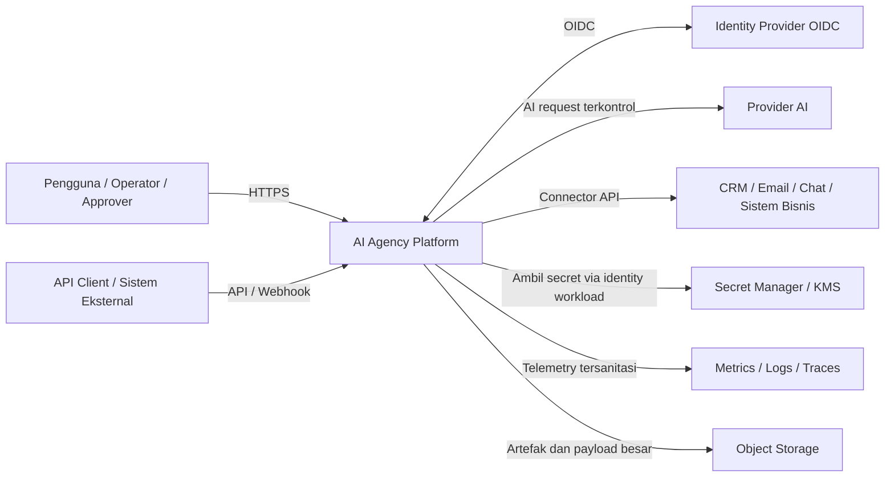
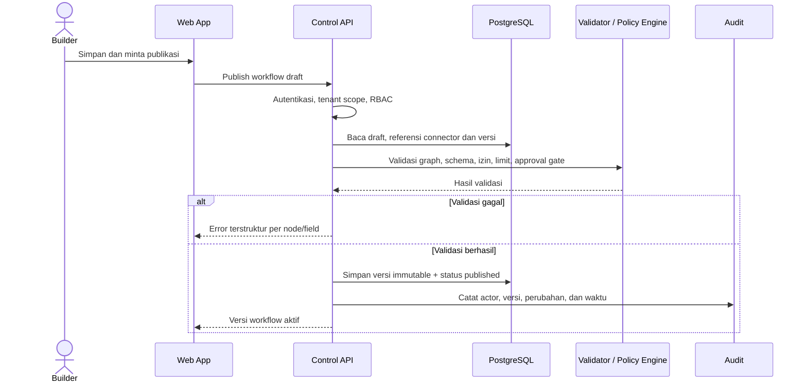
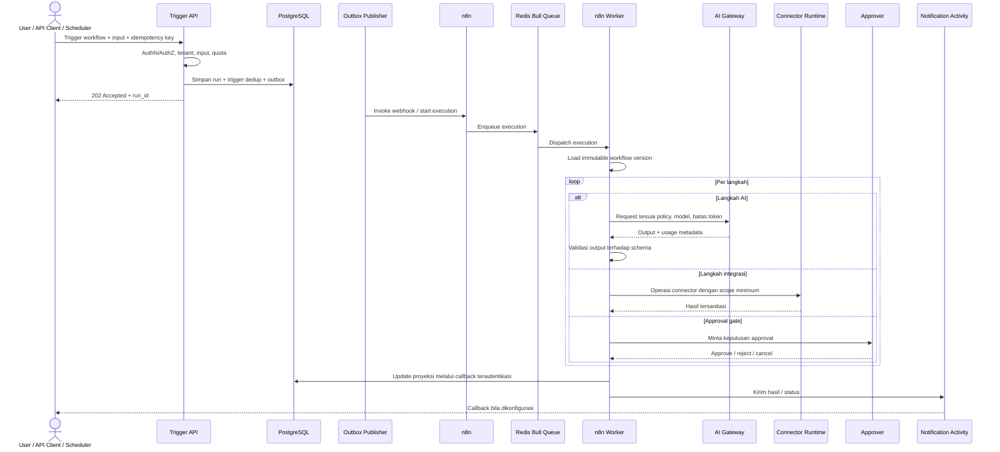
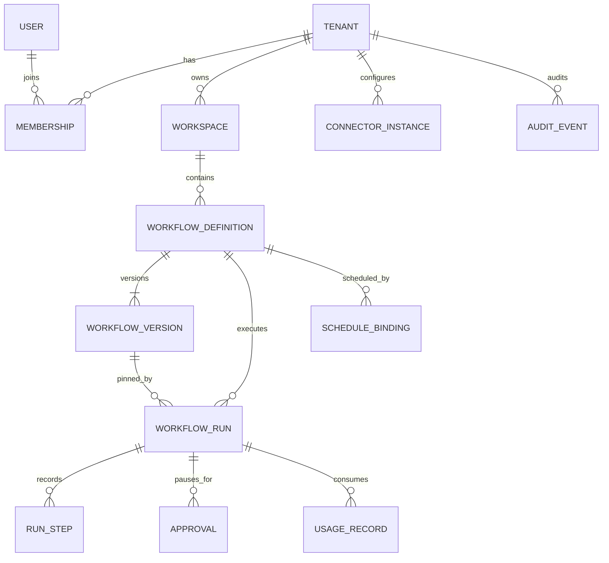
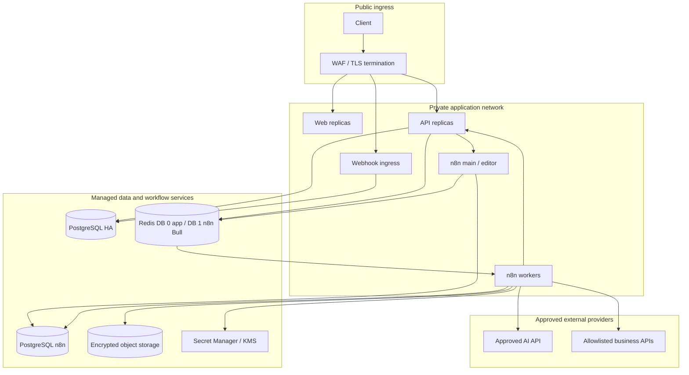

# System Design Document (SDD)

## AI Agency Platform

| Atribut | Nilai |
|---|---|
| Versi dokumen | 1.1 |
| Status | Draft baseline, diselaraskan dengan implementasi n8n Sprint 2 |
| Tanggal | 31 Oktober 2026 |
| Referensi kebutuhan | [SRS.md](./SRS.md) |
| Pemilik arsitektur | Belum ditetapkan |

## 1. Tujuan dan Ruang Lingkup Dokumen

Dokumen ini menerjemahkan kebutuhan dalam SRS menjadi rancangan sistem yang dapat digunakan sebagai acuan desain rinci dan implementasi. Dokumen menetapkan batas komponen, alur data, tanggung jawab service, struktur data, mekanisme antrean dan jadwal, pendekatan agent AI, container, serta deployment.

Rancangan mengutamakan MVP yang dapat berkembang tanpa memulai dengan kumpulan microservice yang sulit dioperasikan. Komponen eksternal, penyedia cloud, dan provider AI tetap dapat diganti melalui adapter. Nilai kapasitas dan SLO harus dikonfirmasi melalui discovery dan uji beban.

### 1.1 Keputusan baseline

| Area | Keputusan rancangan |
|---|---|
| Frontend | React + TypeScript, aplikasi web Next.js. |
| Backend | NestJS + TypeScript sebagai standar backend MVP. |
| Arsitektur aplikasi | Modular monolith untuk control plane; API dan n8n execution plane dijalankan sebagai workload/container terpisah. |
| Orkestrasi MVP | n8n sebagai workflow engine, dijalankan dalam queue mode dengan main process dan worker. |
| Database aplikasi | PostgreSQL sebagai sumber kebenaran untuk konfigurasi, metadata, dan proyeksi operasional. |
| Queue/event | Redis Bull queue milik n8n untuk dispatch eksekusi; PostgreSQL terpisah untuk state n8n dan database aplikasi. |
| Cache/rate limit | Redis database 1 digunakan n8n queue mode; database 0 dicadangkan untuk kebutuhan platform API. |
| Secrets | Secret manager/KMS yang dikelola; basis data hanya menyimpan reference dan metadata. |
| Deployment | Container OCI; MVP dapat dijalankan di managed container platform, dengan Kubernetes sebagai pilihan saat kebutuhan skala/isolasi operasional membenarkan. |

n8n adalah workflow engine yang dipilih untuk MVP dan dioperasikan sebagai layanan terpisah dari API. PostgreSQL n8n menyimpan metadata dan riwayat eksekusi n8n; PostgreSQL aplikasi tetap menyimpan data domain platform. Redis digunakan n8n untuk queue mode, bukan sebagai sumber data domain. Kapabilitas enterprise seperti kontrol multi-tenant, approval, dan observabilitas run harus tetap ditegakkan oleh API dan tidak diasumsikan tersedia otomatis dari n8n.

Implementasi Sprint 1/2 mencakup API NestJS, health checks, Compose, dan workflow AI Content Factory n8n (Form Trigger → API generate → Notion → WhatsApp preview). UI, katalog workflow multi-tenant, approvals, outbox, dan run projection dalam dokumen ini adalah target arsitektur lanjutan, bukan klaim fitur yang sudah tersedia.

### 1.2 Batas sistem

**Di dalam platform:** UI, API, autentikasi/otorisasi aplikasi, katalog workflow dan versi, runtime workflow, AI gateway, connector runtime, approval, penjadwalan, run history, audit, metrik penggunaan, dan notifikasi.

**Di luar platform:** identity provider, model/provider AI, sistem bisnis pelanggan, object storage, secret manager, dan backend observability. Platform mengintegrasikan layanan tersebut melalui protokol dan adapter terkontrol.

### 1.3 Asumsi dan keputusan terbuka

- Isolasi multi-tenant diwajibkan; strategi database awal adalah shared PostgreSQL dengan `tenant_id` wajib dan Row-Level Security (RLS) sebagai pertahanan tambahan. Dedicated database per tenant dapat menjadi tier berikutnya.
- Workflow yang diterbitkan immutable. Workflow run menyimpan referensi versi immutable yang digunakan ketika run dibuat.
- Payload besar tidak disimpan di kolom transaksi; object storage dipakai bila ukuran atau retensi membutuhkannya.
- Provider AI, region data, jenis deployment, target regulasi, kapasitas, serta SLA final masih memerlukan persetujuan pemilik produk dan keamanan.
- n8n dijalankan dengan main/editor dan worker terpisah dalam queue mode; konfigurasi, credential encryption key, dan database internal n8n dipisahkan dari data aplikasi.

## 2. Arsitektur Sistem

### 2.1 Gaya arsitektur

Sistem menggunakan **modular monolith untuk control plane** dengan **execution plane terpisah secara proses**:

- Control plane menangani autentikasi aplikasi, administrasi tenant, desain/publikasi workflow, konfigurasi connector, API pemicu, dan query operasional.
- Execution plane menjalankan workflow pada n8n main/worker. n8n menggunakan Redis Bull queue untuk dispatch dan PostgreSQL n8n untuk metadata serta execution history.
- API memvalidasi request dan memulai workflow melalui webhook/API n8n; PostgreSQL aplikasi menyimpan domain data dan proyeksi yang diperlukan UI/API. Sinkronisasi run ke database aplikasi dilakukan melalui callback/webhook yang terautentikasi atau pola inbox/outbox saat run tracking diperkenalkan.
- Semua komponen aplikasi mengirim trace, metrik, dan log terstruktur ke backend observability.

Pendekatan ini membuat MVP tetap sederhana untuk tim, tetapi mencegah request API menjadi proses panjang dan memungkinkan worker diskalakan secara independen.

### 2.2 Diagram konteks



### 2.3 Diagram komponen

```mermaid
flowchart TB
    subgraph Edge["Boundary publik"]
        WAF[WAF / Load Balancer]
        Web[Web App - Next.js]
        API[API Service - NestJS]
        Hook[Webhook / Trigger Endpoint]
    end

    subgraph Control["Control plane"]
        Auth[AuthN / AuthZ]
        Tenant[Tenant & Workspace]
        Builder[Workflow Catalog & Versioning]
        ConnectorCfg[Connector Configuration]
        Approval[Approval & Operator API]
        RunQuery[Run Query & Reporting]
        Audit[Audit & Usage]
        Inbox[Webhook Inbox / Outbox]
    end

    subgraph Execution["Execution plane"]
        N8n[n8n Main / Editor]
        N8nWorker[n8n Workers]
        AIGateway[AI Gateway & Policy]
        ConnectorRuntime[Connector Runtime]
        Notify[Notification Activity]
    end

    subgraph Data["Data plane"]
        PG[(PostgreSQL App DB)]
        Redis[(Redis: DB 0 platform / DB 1 n8n Bull)]
        N8nDB[(PostgreSQL n8n)]
        Obj[(Object Storage)]
        Secret[Secret Manager / KMS]
    end

    subgraph External["External services"]
        OIDC[OIDC Identity Provider]
        Models[AI Providers]
        Connectors[Business Systems]
        Observability[OpenTelemetry Backend]
    end

    WAF --> Web
    WAF --> API
    WAF --> Hook
    Web --> API
    API --> Auth
    Auth <--> OIDC
    API --> Tenant
    API --> Builder
    API --> ConnectorCfg
    API --> Approval
    API --> RunQuery
    API --> Audit
    Hook --> Inbox
    Tenant --> PG
    Builder --> PG
    ConnectorCfg --> PG
    Approval --> PG
    RunQuery --> PG
    Audit --> PG
    Inbox --> PG
    API --> N8n
    N8n --> API
    N8n --> Redis
    Redis --> N8nWorker
    N8n --> N8nDB
    N8nWorker --> N8nDB
    N8nWorker --> AIGateway
    N8nWorker --> ConnectorRuntime
    N8nWorker --> Notify
    AIGateway --> Models
    ConnectorRuntime --> Connectors
    ConnectorRuntime --> Secret
    AIGateway --> Secret
    N8nWorker --> Obj
    API --> Redis
    API --> Observability
    N8nWorker --> Observability
```



### 2.4 Boundary dan aliran tanggung jawab

1. Browser dan API client hanya berkomunikasi dengan endpoint publik melalui TLS dan WAF/load balancer.
2. API memverifikasi identitas, tenant context, role, skema, kuota, dan hak akses sebelum operasi domain.
3. API menyimpan perubahan domain di PostgreSQL. Untuk operasi trigger yang harus durable, gunakan transactional outbox dan publisher/reconciler; endpoint sprint awal belum menyediakan penyimpanan run/outbox.
4. Workflow n8n dapat dimulai melalui Form/Webhook Trigger atau endpoint n8n internal yang ditetapkan. Untuk AI Content Factory Sprint 2, n8n memanggil endpoint API internal yang terlindungi token; n8n menyimpan execution history di database internalnya dan queue mode mengirim execution melalui Redis Bull kepada worker.
5. AI Gateway dan Connector Runtime memberlakukan policy dan credential scope sebelum request keluar dari platform.
6. UI membaca proyeksi run dan audit dari API. UI tidak mengakses database atau API n8n secara langsung.
7. Telemetry tidak menyimpan prompt/payload sensitif secara default.

## 3. Alur Workflow

### 3.1 Publish workflow



Publikasi tidak mengubah versi lama. Rollback mengubah pointer versi aktif ke versi terdahulu yang valid, bukan mengedit isi versi.

### 3.2 Eksekusi run



**Aturan konsistensi eksekusi:**

- `run_id` aplikasi dan n8n `execution_id` adalah identifier berbeda; simpan pemetaan keduanya pada proyeksi run saat tracking diimplementasikan.
- Idempotency key memiliki scope tenant + workflow + endpoint dan masa retensi yang ditentukan konfigurasi.
- Start workflow yang harus andal menggunakan outbox/reconciliation; endpoint Sprint 2 saat ini memanggil API langsung dan belum memiliki run/outbox persistence.
- Eksekusi n8n dapat diulang sesuai konfigurasi retry node/workflow; node yang menimbulkan efek samping harus menggunakan idempotency key eksternal bila didukung.
- n8n execution history adalah sumber diagnostik eksekusi; PostgreSQL aplikasi menjadi sumber query domain saat run tracking/projection diterapkan.
- Pembatalan run harus menggunakan API n8n yang terotorisasi dan tercatat; request eksternal yang sudah berjalan belum tentu dapat dibatalkan.

### 3.3 Approval dan resume

1. Workflow mencapai approval gate dan menunggu webhook/trigger lanjutan yang memuat keputusan terautentikasi, dengan timeout sesuai policy.
2. Run berpindah ke `waiting_approval`; approval record menyimpan approver, keputusan, alasan opsional, waktu, dan versi workflow.
3. Approver harus berada dalam tenant/workspace yang tepat dan memiliki izin untuk aksi tersebut.
4. Penolakan mengakhiri run sebagai rejected/failed sesuai model status UI; persetujuan melanjutkan workflow melalui jalur resume yang dirancang di n8n.
5. Jika approval kadaluarsa, policy menentukan fail, cancel, atau escalation; tidak ada approval otomatis sebagai fallback.

## 4. Struktur Service

### 4.1 Proses deployment

Walaupun domain code satu codebase pada MVP, unit runtime dipisah untuk skala dan keamanan:

| Workload | Tanggung jawab | Akses utama |
|---|---|---|
| `web` | UI dan aset frontend | API publik |
| `api` | REST API, validasi input, endpoint integrasi internal, trigger dan query | PostgreSQL aplikasi, n8n API/webhook, Redis aplikasi bila diperlukan |
| `webhook-ingress` | Validasi signature, replay protection, durable acceptance dan dedup event eksternal | PostgreSQL inbox/outbox, secret reference untuk verifikasi signature |
| `n8n` | Editor, API/webhook trigger, pengelolaan workflow dan dispatch execution | PostgreSQL n8n dan Redis queue |
| `n8n-worker` | Menjalankan workflow execution dalam queue mode | Redis queue, PostgreSQL n8n, API dan provider eksternal yang diizinkan |
| `scheduler` | Jadwal memakai Schedule Trigger n8n; custom scheduler belum diperlukan untuk MVP | n8n; konfigurasi workflow disimpan n8n |
| `migrations` | Migrasi skema terkontrol saat deployment | PostgreSQL aplikasi |

Di MVP, webhook ingress dapat menjadi modul/process API selama isolasi ingress dan kapasitasnya memadai. Proses deployment terpisah direkomendasikan sebelum menerima volume webhook tinggi atau kebutuhan network policy berbeda.

### 4.2 Modul domain backend

- **Identity & Access:** pemetaan subject identity provider ke user, role, permission, dan session policy.
- **Tenant & Workspace:** tenant context, workspace, keanggotaan, kuota, serta policy.
- **Workflow Catalog:** draft, graph, schema, version, status publikasi, template, dan lifecycle.
- **Workflow Validation:** validasi graph, konfigurasi, referensi resource, dan aturan keamanan saat publish.
- **Execution Management:** penerimaan trigger, idempotency, run metadata, cancel, status projection, serta hubungan rerun.
- **Approval:** inbox persetujuan, policy routing, keputusan, timeout, dan audit.
- **Connector Registry:** tipe connector, konfigurasi non-secret, credential reference, scope, kesehatan, dan lifecycle.
- **AI Gateway:** adapter provider, model allowlist, policy, usage/cost metadata, batas input/output, serta redaction.
- **Audit & Usage:** event append-oriented, pencatatan biaya/pemakaian, dan ekspor terkendali.
- **Notification:** preference, template, dan delivery result.
- **Observability:** correlation, metrics, tracing, logging tersanitasi, serta health checks.

### 4.3 Aturan dependensi modul

- Modul domain tidak boleh mengakses tabel modul lain secara langsung tanpa repository/interface yang disepakati.
- Adapter eksternal berada di lapisan infrastructure; domain memakai interface internal agar provider dapat diganti.
- Controller/API hanya melakukan validasi batas dan orkestrasi aplikasi; aturan bisnis berada di service domain/use case.
- Workflow n8n mengatur urutan node; operasi eksternal menggunakan credential dan node yang disetujui. Jangan menaruh secret pada workflow JSON atau data eksekusi yang diekspor.
- Semua operasi yang mengubah state tenant membawa `tenant_id` eksplisit dari konteks terautentikasi, bukan dari payload yang dipercaya.

## 5. Struktur Folder yang Direkomendasikan

Struktur berikut adalah rancangan organisasi repository, bukan file implementasi. Nama package final dapat disesuaikan setelah repo dan toolchain ditetapkan.

```text
ai-agency/
  apps/
    web/                         # Next.js UI
    api/                         # NestJS control-plane API
    n8n/                         # Workflow exports, templates, dan dokumentasi import
    webhook-ingress/             # Ingress terisolasi bila dibutuhkan
  packages/
    contracts/                   # DTO/schema API, event, dan shared types
    workflow-domain/             # Model domain dan aturan workflow
    workflow-validation/         # Validator graph, schema, dan policy
    connector-sdk/               # Interface dan helper connector
    ai-provider-sdk/             # Interface adapter provider AI
    observability/               # OpenTelemetry setup dan redaction
    config/                      # Validasi konfigurasi environment
  infrastructure/
    containers/                  # Definisi image/build yang digunakan
    local/                       # Topologi dependensi lokal
    deployment/                  # Manifests/IaC sesuai target deployment
    monitoring/                  # Dashboard, alert, dan konfigurasi telemetry
  database/
    app-migrations/              # Migrasi database aplikasi
    n8n/                         # Konfigurasi deployment n8n dan setup database terpisah
  docs/
    architecture/                # SRS/SDD, ADR, diagram, runbook
    api/                         # Kontrak API
  tests/
    integration/
    contract/
    security/
    load/
```

**Panduan struktur modul NestJS:**

```text
apps/api/src/
  modules/
    identity/
    tenants/
    workspaces/
    workflows/
    executions/
    approvals/
    connectors/
    usage/
    audit/
    notifications/
  common/
  infrastructure/
  main/
```

Struktur ini menjadi arahan navigasi saja. Jangan memecah package atau service secara fisik sebelum batas kepemilikan, kebutuhan deploy independen, dan biaya operasionalnya terbukti.

## 6. Database

### 6.1 Database aplikasi

PostgreSQL menyimpan domain data aplikasi dan read model untuk UI. Tabel yang dapat diakses lintas tenant harus memiliki `tenant_id` atau berada pada tabel global yang aksesnya dibatasi jelas.

| Entitas/tabel konseptual | Kolom penting | Catatan |
|---|---|---|
| `tenants` | `id`, `name`, `status`, `region`, `created_at` | Tenant lifecycle dan kebijakan umum. |
| `users` | `id`, `identity_subject`, `email`, `status` | Subject identity provider unik; data profil minimum. |
| `memberships` | `tenant_id`, `user_id`, `status` | Relasi user terhadap tenant. |
| `roles` / `permissions` / `role_bindings` | scope, resource, action, actor | RBAC; role binding dapat berlaku tenant/workspace/workflow. |
| `workspaces` | `id`, `tenant_id`, `name`, `status` | Batas kolaborasi dalam tenant. |
| `workflow_definitions` | `id`, `tenant_id`, `workspace_id`, `name`, `owner_id`, `active_version_id`, `status` | Identitas stabil workflow, bukan isi versi. |
| `workflow_versions` | `id`, `workflow_id`, `version`, `definition_json`, `input_schema`, `output_schema`, `published_at`, `created_by` | Versi draft/published; published immutable. |
| `connector_instances` | `id`, `tenant_id`, `workspace_id`, `connector_type`, `config_json`, `credential_ref`, `status` | `config_json` tidak boleh mengandung secret. |
| `workflow_runs` | `id`, `tenant_id`, `workflow_id`, `workflow_version_id`, `n8n_workflow_id`, `n8n_execution_id`, `trigger_type`, `status`, `requested_by`, timestamps | Proyeksi untuk query dan reporting; bukan penyimpanan state internal n8n. |
| `run_steps` | `id`, `run_id`, `step_key`, `attempt`, `status`, timestamps, `error_code`, `result_ref` | Simpan ringkasan tersanitasi; payload besar di object storage. |
| `approvals` | `id`, `tenant_id`, `run_id`, `step_key`, `status`, `requested_at`, `decided_by`, `decision_at` | Keputusan harus dapat diaudit dan diproteksi dari duplikasi. |
| `idempotency_records` | `tenant_id`, `scope`, `key_hash`, `run_id`, `expires_at` | Simpan hash key, bukan key asli bila tidak diperlukan. Unique constraint pada scope. |
| `inbox_events` | `id`, `tenant_id`, `source`, `external_event_id`, `received_at`, `status`, `payload_ref` | Durable webhook/event intake dan replay/dedup. |
| `outbox_events` | `id`, `tenant_id`, `event_type`, `aggregate_id`, `payload`, `created_at`, `published_at` | Menjembatani transaksi database ke pemicu workflow n8n/notifikasi. |
| `audit_events` | `id`, `tenant_id`, `actor_id`, `action`, `target`, `occurred_at`, `correlation_id`, `metadata` | Append-oriented; payload sensitif dilarang secara default. |
| `usage_records` | `id`, `tenant_id`, `run_id`, `provider`, `model`, `input_units`, `output_units`, `estimated_cost`, `occurred_at` | Metadata pemakaian dan biaya, tanpa prompt secara default. |
| `schedule_bindings` | `id`, `tenant_id`, `workflow_id`, `workflow_version_id`, `n8n_workflow_id`, `cron_spec`, `timezone`, `enabled` | Referensi workflow n8n terjadwal dan status konfigurasi produk. |
| `notifications` | `id`, `tenant_id`, `recipient_id`, `event_type`, `status`, `sent_at` | Status delivery; isi notifikasi meminimalkan data pribadi. |

### 6.2 Relasi domain



### 6.3 Isolasi, indeks, dan retensi

- RLS menjadi pertahanan tambahan; setiap request memperoleh tenant context dari sesi/token yang tervalidasi. Pool koneksi harus mengatur dan membersihkan tenant context per transaksi agar tidak bocor antar-request.
- Repository/query wajib memfilter tenant secara eksplisit, meskipun RLS aktif. Uji negatif lintas tenant menjadi bagian test suite.
- Unique key, foreign key, dan indeks lookup harus memasukkan `tenant_id` bila berlaku. Indeks awal: `(tenant_id, status, created_at)` untuk run; `(tenant_id, workflow_id, created_at)`; `(tenant_id, workspace_id, status)`; serta unique `(tenant_id, scope, key_hash)` untuk idempotency.
- Payload sensitif tidak ditempatkan di audit log. Data run, output AI, dan dokumen memiliki retensi dan penghapusan terpisah, dengan referensi object storage bila diperlukan.
- Partisi tabel event/run hanya setelah volume dan pola query membuktikannya diperlukan; jangan memulai dengan partisi kompleks tanpa metrik.
- Database aplikasi dan database internal n8n adalah persistence terpisah; backup, restore, akses, dan retensinya dikelola serta diuji secara terpisah.

### 6.4 Database n8n

n8n memakai PostgreSQL terpisah dari database aplikasi untuk credential terenkripsi, konfigurasi, workflow, dan execution metadata. Dalam Compose, database dan user n8n dibuat terpisah; jangan menggabungkan tabel internal n8n dengan skema domain aplikasi. Redis queue mode juga terpisah secara logical: database 1 digunakan n8n, sedangkan database 0 dicadangkan untuk platform API.

## 7. Queue dan Event Delivery

### 7.1 Jenis antrean

1. **n8n queue mode** menggunakan Redis Bull queue untuk dispatch execution dari main process ke worker.
2. **PostgreSQL inbox** menahan webhook/event sampai validasi, deduplikasi, dan persistensi selesai.
3. **PostgreSQL transactional outbox** dapat menjamin pemicu n8n dapat diterbitkan ulang setelah kegagalan proses saat run persistence diterapkan.
4. Redis adalah queue transport n8n; metadata dan execution history n8n disimpan di PostgreSQL n8n. Jangan memakai queue Redis sebagai satu-satunya sumber rekonsiliasi bisnis.
5. Untuk fan-out/throughput tinggi, evaluasi broker/event platform secara terpisah; bukan bagian Sprint 2.

### 7.2 Task queue yang disarankan

| Logical queue / workflow class | Aktivitas |
|---|---|
| `workflow-orchestration` | Workflow orchestration yang deterministik dan pemrosesan state. |
| `activity-default` | Transformasi ringan, validasi, dan aktivitas internal. |
| `activity-ai` | Pemanggilan provider AI dengan batas konkurensi dan biaya terpisah. |
| `activity-connectors` | Pemanggilan sistem eksternal; dapat dipisahkan lebih lanjut per risk tier/network boundary. |
| `activity-notifications` | Pengiriman email, chat, dan callback. |

Nama di tabel adalah klasifikasi desain, bukan konfigurasi Bull queue yang otomatis dibuat. Pisahkan workflow berisiko atau beregress berbeda ke deployment/worker pool dan network policy terpisah bila skala serta kebutuhan keamanan membenarkannya.

### 7.3 Delivery, retry, dan backpressure

- Delivery diasumsikan **at-least-once**; setiap consumer/activity yang relevan harus idempoten atau menggunakan deduplication key.
- Retry hanya untuk error sementara dan dibatasi maksimum attempt, initial interval, exponential backoff, serta maximum interval.
- Error validasi, otorisasi, policy, atau input tidak valid bersifat non-retryable kecuali ditetapkan eksplisit.
- Connector memiliki concurrency/rate limit per provider dan tenant, disertai timeout dan circuit breaker pada adapter bila tepat.
- Backpressure dilakukan dengan membatasi jumlah workflow start, worker concurrency, dan per-tenant quota; sistem tidak menerima pekerjaan tanpa batas.
- Run yang melewati batas percobaan masuk status gagal/operational review; tidak boleh disembunyikan sebagai sukses.
- Pada mode queue n8n, pantau backlog Redis dan status worker; outbox publisher/reconciler hanya diperlukan untuk pemicu yang harus konsisten dengan transaksi aplikasi.

## 8. Scheduler

n8n Schedule Trigger menjadi sumber eksekusi jadwal MVP. Jangan menambah cron process per replica API. Jadwal harus diuji pada workflow aktif dan timezone yang ditetapkan; kemampuan overlap/catch-up perlu diverifikasi terhadap versi n8n yang dipasang.

### 8.1 Operasi jadwal

1. Admin membuat jadwal untuk workflow dan versi yang telah diterbitkan.
2. API memvalidasi timezone, cron spec, batas frekuensi, hak akses, kuota, dan idempotensi.
3. API menyimpan `schedule_binding` dan menerapkan konfigurasi workflow n8n melalui mekanisme terkontrol; API n8n tidak boleh diekspos ke client publik.
4. n8n Schedule Trigger menginisiasi execution sesuai konfigurasi workflow; execution menyertakan scheduled time dan trigger metadata bila tersedia.
5. Run menggunakan idempotency key deterministik berdasarkan schedule ID dan waktu occurrence agar overlap/retry tidak membuat duplikasi.
6. Disable/update jadwal harus tersinkron dengan status workflow n8n dan audit event; reconciliation job diperlukan saat pengelolaan terprogram ditambahkan.

### 8.2 Kebijakan jadwal

- Timezone disimpan sebagai IANA timezone; tampilan UTC juga disediakan untuk audit.
- Kebijakan saat jadwal terlewat (catch-up, skip, atau satu kali catch-up) harus dapat dipilih sesuai workflow.
- Kebijakan overlap default adalah skip atau buffer satu run; paralel hanya jika workflow dinyatakan aman.
- Tenant quota dan batas frekuensi mencegah jadwal menghasilkan beban yang tidak terkendali.
- Perubahan jadwal tidak mengubah workflow version yang sudah dipin oleh konfigurasi, kecuali pengguna secara eksplisit memilih versi baru.

## 9. AI Agent dan AI Gateway

### 9.1 Model eksekusi

Pada MVP, agent dibatasi sebagai **workflow step yang dikendalikan**, bukan loop otonom tanpa batas. Workflow deterministik mengatur urutan; langkah AI menyarankan/menyusun hasil dalam kontrak terdefinisi; connector melakukan tindakan hanya dengan izin yang telah dikonfigurasi.

### 9.2 Komponen AI

- **AI Gateway:** adapter provider, model allowlist, batas biaya/token, timeout, retry policy, redaction, usage metadata, dan provider routing.
- **Agent Runtime Activity:** menyiapkan konteks prompt dari input yang diizinkan, mengeksekusi model, memvalidasi hasil, dan mengembalikan output terstruktur.
- **Tool Registry:** daftar tool dengan schema, permission, risk tier, dan tenant/workflow binding.
- **Policy Enforcement:** mencegah akses model/tool/sumber yang tidak diizinkan; memeriksa aksi berisiko dan approval.
- **Optional Retrieval Service (fase lanjut):** mengembalikan dokumen yang diizinkan oleh ACL, metadata sumber, dan referensi kutipan.

### 9.3 Kontrak langkah AI

Setiap langkah AI memiliki:

- `provider` dan model alias yang disetujui (bukan endpoint bebas dari input pengguna).
- System/developer instruction yang disimpan bersama workflow version dan diperlakukan sebagai konfigurasi tepercaya.
- User input/context yang memiliki provenance; isi dari user, dokumen, connector, dan tool diperlakukan sebagai data tak tepercaya.
- Batas token input/output, timeout, temperatur atau parameter lain yang didukung, dan budget biaya.
- Schema output yang divalidasi sebelum hasil diteruskan.
- Policy untuk redaction, persistensi, lokasi data, fallback provider, serta human review.
- Metadata provider/model, token/usage, latency, biaya estimasi, dan hasil validasi.

### 9.4 Kontrol keamanan agent

1. Tidak ada akses jaringan bebas dari model atau tool; hanya adapter allowlisted yang dapat melakukan egress.
2. Model tidak menerima secret mentah. Connector memperoleh credential reference melalui secret manager pada activity yang terotorisasi.
3. Prompt injection diperlakukan sebagai risiko; instruksi yang ditemukan di konten retrieval/tool tidak menaikkan hak akses atau mengubah policy.
4. Output AI tidak boleh langsung menjalankan operasi sensitif tanpa schema validation, policy check, dan approval yang diwajibkan.
5. Fallback provider tidak otomatis dilakukan bila dapat mengubah lokasi atau kebijakan data; perubahan provider harus lolos policy.
6. Payload prompt/response tidak disimpan di log secara default; jika perlu untuk debugging/evaluasi, diperlukan konfigurasi eksplisit, masking, akses terbatas, dan retensi singkat.
7. Workflow AI dapat dibatasi per tenant, provider, model, sumber data, tools, biaya, concurrency, serta jadwal evaluasi.

## 10. Docker dan Container

### 10.1 Prinsip container

- Setiap workload aplikasi (web, API, worker, ingress bila dipisah) dibangun sebagai image OCI immutable dan diberi tag versi/commit.
- Gunakan build multi-stage, user non-root, filesystem read-only bila kompatibel, dependency minimum, health check, dan sinyal shutdown yang ditangani dengan graceful.
- Secret tidak dimasukkan ke image, build argument, atau file konfigurasi source-controlled; gunakan workload identity dan secret manager.
- Image ditandatangani/dipindai sesuai pipeline organisasi; deployment menggunakan image digest yang telah diverifikasi.
- Resource request/limit, concurrency worker, dan shutdown grace period diatur berdasarkan uji beban dan batas aktivitas.

### 10.2 Topologi development lokal

Lingkungan lokal Sprint 1/2 menyediakan API, PostgreSQL aplikasi, PostgreSQL n8n, Redis, n8n main, dan n8n worker. Object storage dan OpenTelemetry collector dapat ditambahkan bila diperlukan. Provider AI dan sistem bisnis menggunakan mock/sandbox; jangan memakai credential produksi.

Topologi lokal harus memiliki health check dan volume yang terpisah untuk PostgreSQL serta Redis. Konfigurasi Compose lokal bukan konfigurasi production; environment production membutuhkan TLS, secret management, akses n8n terbatas, persistence terkelola, dan kebijakan retensi execution data.

### 10.3 Batas container

- Container API tidak menjalankan workflow panjang secara sinkron.
- Worker tidak menerima traffic publik langsung.
- Container worker AI dan connector dapat menggunakan service account dan egress policy terpisah.
- Container migrasi dijalankan sebagai job satu kali terkontrol, bukan saat setiap replica aplikasi startup.
- Log stdout/stderr berupa struktur JSON; payload dan secret disaring sebelum emit.

## 11. Deployment

### 11.1 Topologi lingkungan



### 11.2 Tahapan deployment

1. **Development:** data sintetis, mocks, identitas lokal, pemeriksaan cepat.
2. **CI:** lint/type-check/test, dependency dan secret scan, build image, SBOM, image scan.
3. **Staging:** konfigurasi mendekati production, test migrasi, integrasi sandbox, smoke, contract, dan uji beban terbatas.
4. **Production:** persetujuan release, image digest immutable, migrasi kompatibel, canary/rolling deployment, dashboard dan rollback plan.

### 11.3 Deployment MVP dan evolusi

- **MVP/pilot:** container platform untuk API dan n8n main/worker; PostgreSQL terpisah untuk aplikasi dan n8n; Redis untuk queue mode n8n.
- **Enterprise/scale:** cluster Kubernetes terkelola jika dibutuhkan isolasi worker, autoscaling berbasis backlog, network policy, deployment multi-service, atau kontrol infrastruktur lebih rinci.
- Hindari menambah platform orkestrasi infrastruktur yang kompleks sebelum volume dan kebutuhan operasional membenarkannya. Amankan editor/API n8n di jaringan privat atau di balik akses operator yang dibatasi.
- Dev, staging, dan production memiliki akun/proyek, database, credential, dan identitas workload yang terpisah.

### 11.4 Autoscaling dan ketersediaan

- API diskalakan berdasarkan CPU/memori, request rate, dan p95 latency.
- n8n worker diskalakan berdasarkan backlog Bull queue, latency antrean, serta batas provider/tenant; autoscaling tidak boleh melanggar concurrency quota.
- PostgreSQL memiliki HA, backup terenkripsi, point-in-time recovery, dan restore drill.
- n8n main/worker, Redis, dan PostgreSQL n8n memerlukan HA serta prosedur backup/restore sesuai target RPO/RTO.
- Availability target baseline SRS adalah 99,5% per bulan; RPO awal ≤ 15 menit dan RTO ≤ 4 jam. Target ini harus divalidasi dan diuji sebelum komitmen SLA.

### 11.5 Network dan secret

- Hanya WAF/load balancer dan endpoint webhook yang memang diperlukan yang publik; editor/API n8n, database, Redis, worker, dan object storage berada di private network.
- Egress worker dibatasi ke provider AI, sistem bisnis, DNS, dan layanan yang diperlukan.
- Gunakan TLS antar komponen yang mendukung; secret ditarik saat runtime melalui workload identity dengan hak minimum.
- Akses operator ke lingkungan production melalui identitas terfederasi dan audit; tidak membuka akses database publik.

### 11.6 Upgrade dan rollback

- Skema aplikasi menggunakan migrasi expand/contract agar versi aplikasi lama dan baru dapat berjalan selama rolling deployment.
- Workflow export yang dirilis harus ditinjau dan diberi version control; perubahan workflow aktif mengikuti proses publish/rollback n8n.
- Perubahan node atau credential harus diuji terhadap execution yang sedang berjalan dan kompatibilitas versi n8n sebelum upgrade.
- Rollback aplikasi dilakukan ke image digest sebelumnya; migrasi destructive ditunda sampai versi lama tidak lagi digunakan dan backup/restore tervalidasi.

## 12. Observability dan Operasi

### 12.1 Correlation dan tracing

`trace_id` diteruskan dari request masuk ke outbox, n8n execution, node integrasi, AI Gateway, connector, serta callback. Simpan pemetaan `run_id` aplikasi dan n8n `execution_id` bila run projection diaktifkan. Jangan menaruh data pribadi atau secret dalam baggage/metric labels.

### 12.2 Metrik operasi

- API: availability, request rate, p95/p99 latency, error rate, dan auth denial.
- n8n: Bull queue backlog, execution start/completion/failure, retry, scheduler health, worker availability, serta kapasitas dan retensi execution data.
- Connector/AI: latency, error class, rate limit, token usage, estimated cost, dan provider health.
- Produk: run success rate, waiting approval age, biaya per workflow/tenant, kuota, dan run yang tertahan.
- Data: koneksi PostgreSQL, pool exhaustion, storage growth, backup, dan replication health.

Implementasi monitoring Sprint 3A mengekspos metrik proses dan HTTP API melalui `GET /metrics` dalam format Prometheus. Prometheus melakukan scrape lokal dan Grafana memuat dashboard API yang diprovisikan dari file. Endpoint metrics tidak berada di bawah prefix `/api/v1`; request scrape tidak dihitung sebagai traffic API, dan label route menggunakan template untuk menghindari cardinality tinggi. Implementasi ini tidak mencakup logging, retry, backup, atau konfigurasi production.

### 12.3 Alert dan tindakan

Alert dipetakan ke runbook dan tingkat keparahan. Minimal: API error/SLO burn, antrean Redis meningkat, worker n8n tidak tersedia, error provider meningkat, biaya mendekati kuota, backlog outbox bila digunakan, jadwal tidak sinkron, kegagalan backup, serta restore drill gagal. Alert wajib memiliki owner dan prosedur eskalasi.

## 13. Ketahanan dan Kegagalan

| Kegagalan | Perilaku rancangan |
|---|---|
| API restart setelah event trigger disimpan | Outbox publisher/reconciler melanjutkan pemicu n8n bila outbox telah diterapkan. |
| n8n worker mati saat execution | Queue mode n8n melanjutkan pekerjaan sesuai perilaku dan konfigurasi retry versi terpasang; aktivitas eksternal wajib idempoten atau memiliki rekonsiliasi. |
| Provider AI/connector melambat | Timeout, concurrency/rate limit, retry terbatas; circuit breaker dapat menahan request baru dan run berakhir dengan status eksplisit. |
| Database aplikasi tidak tersedia | API gagal tertutup untuk operasi mutasi; tidak mengakui trigger sebelum durable commit. |
| Redis tidak tersedia | Fitur cache/rate limit bergantung desain fallback; kontrol keamanan/kuota tidak boleh bergantung pada cache volatile sebagai satu-satunya enforcement. |
| n8n/Redis queue tidak tersedia | API gagal tertutup untuk trigger yang tidak dapat diterima; retry/reconciliation dan alert backlog diperlukan untuk operasi durable. |
| Pengiriman callback gagal | Retry terkontrol melalui activity; status delivery terpisah dari status keberhasilan workflow. |
| Secret dicabut/credential invalid | Activity gagal dengan error tersanitasi, tidak mengulang tanpa batas, dan connector diberi status/peringatan. |

## 14. Keamanan Desain

- Tenant context wajib pada API, query repository, worker activity, queue metadata, storage reference, dan audit.
- Worker memverifikasi kembali tenant dan connector scope saat activity, bukan mengandalkan parameter workflow tanpa validasi.
- Tool/action memiliki allowlist dan schema input; SSRF dicegah dengan membatasi host, protokol, DNS resolution, redirect, dan alamat jaringan privat pada connector HTTP generik.
- Approval disimpan sebagai keputusan identitas manusia dan tidak dapat dilewati oleh prompt atau output model.
- Export dan log menerapkan filter akses serta redaction; object storage memakai enkripsi, lifecycle, dan signed access terbatas bila diperlukan.
- Audit event append-oriented; akses administratif dan perubahan policy turut diaudit.
- Keamanan deployment mencakup IAM least-privilege, network segmentation, image scanning, secret scanning, backup encryption, dan pemisahan environment.

## 15. Keterlacakan ke SRS dan Kriteria Desain

| Kelompok SRS | Dukungan desain |
|---|---|
| FR-001–006, NFR-005 | Tenant context, RBAC, RLS, identity integration, dan isolation test. |
| FR-010–018 | Workflow Catalog, immutable versions, validator, dan publish flow. |
| FR-020–029, NFR-004 | n8n workflow, queue mode, run projection, idempotency, approval, cancel, retry, dan concurrency. |
| FR-030–038 | AI Gateway, policy/tool registry, schema validation, usage, HITL, serta jalur RAG lanjutan. |
| FR-040–045 | Connector Registry/Runtime, secret reference, timeout, rate limit, dan egress control. |
| FR-050–055 | Run projection, audit, usage, query API, telemetry, dan alert. |
| FR-060–063 | API service dengan auth, schema, versioning, rate limit, idempotency, dan dokumentasi kontrak. |
| NFR-001–016 | HA deployment, autoscaling, observability, security, data retention, backup/restore, cost tracking, dan test gates. |

## 16. Tahapan Implementasi Teknis

1. **Fondasi:** repository dan pipeline, identitas, tenant context, PostgreSQL, migrasi, observability, secret manager.
2. **Workflow control plane:** definisi, draft/version, validator, publish, RBAC, API kontrak.
3. **Execution plane:** n8n main/worker queue mode, trigger/outbox, status projection, retry, cancellation, dan idempotency.
4. **AI & connector:** AI Gateway satu provider, HTTP connector terkelola, schema validation, usage tracking, policy dan approval.
5. **Operasi pilot:** run UI, audit, dashboard, notifikasi, quota, backup/restore, security test, dan runbook.
6. **Enterprise hardening:** SSO, connector spesifik, HA/DR, evaluasi model, deployment privat atau skala lebih besar bila didukung kebutuhan.

Tahapan ini perlu direncanakan ulang terhadap roadmap dan kapasitas tim pada SRS; tidak mengubah prioritas bisnis tanpa persetujuan Product Owner.

## 17. Keputusan Arsitektur yang Memerlukan Persetujuan

1. Model operasi n8n self-hosted atau layanan terkelola berdasarkan region, lisensi, keamanan, dan kemampuan operasi.
2. Managed container platform atau Kubernetes untuk production awal.
3. Shared PostgreSQL + RLS atau database dedicated bagi tier enterprise tertentu.
4. Provider/model AI yang diizinkan dan kebijakan data residency/retensi.
5. Broker event tambahan selain Redis queue n8n dan PostgreSQL outbox berdasarkan proyeksi volume.
6. Retensi payload/output dan object storage berdasarkan klasifikasi data pelanggan.
7. Batas awal rate, concurrency, retry, ukuran payload, dan anggaran per tenant/workflow.
8. Strategi disaster recovery lintas availability zone/region serta SLA final.

Keputusan di atas dicatat sebagai Architecture Decision Records (ADR) sebelum implementasi yang mengunci pilihan tersebut.
